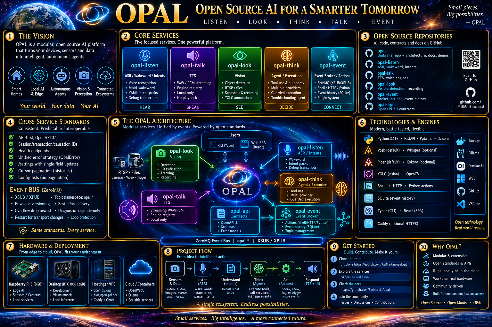

# OPAL



**Build local-first AI tools that can hear, speak, see, reason, and act.** Start with one service. Add another when you need it. A Raspberry Pi can handle voice commands while a separate computer runs the language model.

[Setup](#setup) · [Listen](#listen-test-a-voice-command) · [Say](#say-make-a-wav-file) · [Look](#look-test-a-vision-pipeline) · [Event](#event-turn-a-message-into-an-action) · [Think](#think-ask-a-model-and-track-its-work) · [Combine services](#combine-services)

| Repository | What it does |
| --- | --- |
| [opal-listen](https://github.com/PatMartin/opal-listen) | Recognize speech, match wakewords and intents, extract slots, and run local reactions. |
| [opal-say](https://github.com/PatMartin/opal-say) | Generate speech with Piper or Kokoro. Use voices, profiles, and personas to pick how it sounds. |
| [opal-look](https://github.com/PatMartin/opal-look) | Manage vision sources and pipelines, analyze images, and work with observations and media. |
| [opal-event](https://github.com/PatMartin/opal-event) | Publish events, match rules, execute registered actions, and inspect what ran. |
| [opal-think](https://github.com/PatMartin/opal-think) | Send tasks to Ollama or OpenAI, keep conversation sessions, and call configured Event actions. |
| [opal-api](https://github.com/PatMartin/opal-api) | Read the OpenAPI 3.1 contracts and shared kernel for all five services. |

## Setup

Use Python 3.12 and [uv](https://docs.astral.sh/uv/). Clone the service you want to try and open its checkout in two terminals. Run its setup and service start in one terminal, then run the client examples in the other. Run every command on its own. Where a command uses an ID such as `TASK_ID`, paste the value returned by the preceding command.

Each checkout owns its own `opal` entry point. Running `uv run` inside the corresponding checkout keeps the environments separate. Use the service-specific help to see what your checkout exposes.

The examples use local development endpoints. Listen and Look both default to port 8000, so run them one at a time or move Look to another port and pass the same endpoint to its client.

## Listen: test a voice command

In the Listen checkout, install the package and start the service. Download and extract the [small US English Vosk model](https://alphacephei.com/vosk/models) first. Replace the example path with the extracted model directory.

```console
uv sync
OPAL_LISTENER_VOSK_MODEL_PATH=/absolute/path/to/vosk-model-small-en-us-0.15 uv run opal-listen-svc
```

Test the built-in kitchen-light intent as text, then replay a fixture WAV through speech recognition. The text test is useful when you're editing phrases and want to isolate intent matching from microphone quality.

```console
uv run opal listen service ping
uv run opal listen service doctor
uv run opal listen wakeword list
uv run opal listen intent list
uv run opal listen intent get light_turn_on
uv run opal listen slot values room_name
uv run opal listen test text "computer, turn on the kitchen light" --expect-intent light_turn_on
uv run opal listen test audio resources/cmds/cmd-kitchen-lights-on.wav
uv run opal listen test regression
```

On Debian, Ubuntu, or Raspberry Pi OS, install `libportaudio2` for live microphone use. With a microphone attached to the service host, check the devices and listen for 20 seconds. Use the logs and performance summary to investigate a miss.

```console
uv run opal listen service devices
uv run opal listen test listen-debug --duration 20
uv run opal listen log list --no-match --limit 10
uv run opal listen service perf summary
```

### Trigger a local reaction

Run these commands in the same configuration environment as the Listen service. Reaction commands edit its local `reactions.yaml`. The test below checks the match without executing the action. To try live dispatch, enable reactions and speak the command into the microphone. This example uses `/bin/echo` on Linux.

```console
uv run opal listen reaction add kitchen-demo --cond "intent_name eq light_turn_on" --run "/bin/echo Kitchen light requested"
uv run opal listen reaction test --text "computer, turn on the kitchen light"
uv run opal listen setting set reactions_enabled true
uv run opal listen test listen --duration 20
uv run opal listen reaction log
uv run opal listen reaction remove kitchen-demo
```

## Say: make a WAV file

In the Say checkout, install Piper support. Download the matching `en_US-amy-low.onnx` and `en_US-amy-low.onnx.json` files to `~/piper/voices` on the service host. See [Say model setup](https://github.com/PatMartin/opal-say#2-install-at-least-one-voice-model) for links and Kokoro setup.

```console
uv sync --extra piper
uv run --extra piper opal-say-svc
```

The catalog ID is `en-us-amy-low`. Validate it before generating audio. Open the WAV files in your audio player to compare the two speeds.

```console
uv run --extra piper opal say info ready
uv run --extra piper opal say engine list
uv run --extra piper opal say engine validate piper
uv run --extra piper opal say voice list --engine piper
uv run --extra piper opal say voice validate en-us-amy-low
uv run --extra piper opal say generate "Welcome to the workshop." --voice en-us-amy-low --format wav --output welcome.wav
uv run --extra piper opal say generate "Welcome to the workshop." --voice en-us-amy-low --speed 0.85 --format wav --output welcome-slow.wav
uv run --extra piper opal say profile list
uv run --extra piper opal say persona list
```

## Look: test a vision pipeline

In the Look checkout, use Python 3.12. Use an editable checkout so the client can import its CLI package from `src`. Add PyYAML to the run environment for YAML configuration support. Port 8002 keeps this example separate from Listen.

```console
OPAL_LOOK_PORT=8002 uv run --python 3.12 --with PyYAML opal serve
```

Put a JPG named `sample.jpg` in the Look checkout. Use the built-in synthetic model to exercise the pipeline and inspect persisted observations. Synthetic labels are test data. For RTSP capture and the limits of trained-model inference and live viewing, see [Look's capability notes](https://github.com/PatMartin/opal-look#current-capabilities-and-known-limitations).

```console
uv run --with PyYAML opal look --url http://127.0.0.1:8002 info health ready
uv run --with PyYAML opal look --url http://127.0.0.1:8002 engines list
uv run --with PyYAML opal look --url http://127.0.0.1:8002 models list
uv run --with PyYAML opal look --url http://127.0.0.1:8002 pipelines add --body '{"id":"lab","name":"Image lab","model_id":"synthetic-vision","task":"detection","retention":{"persist_observations":true,"ttl_seconds":3600}}'
uv run --with PyYAML opal look --url http://127.0.0.1:8002 analyze image sample.jpg --request '{"pipeline_id":"lab"}'
uv run --with PyYAML opal look --url http://127.0.0.1:8002 observations list
uv run --with PyYAML opal look --url http://127.0.0.1:8002 media upload sample.jpg --ttl 3600
uv run --with PyYAML opal look --url http://127.0.0.1:8002 media list
```

## Event: turn a message into an action

In the Event checkout, create a new file named `demo-event.yaml` with the following contents. The server uses its default local endpoint on port 8080. The demo registers a Linux executable and a rule in this configuration.

```yaml
persistence:
  database: ./demo-event.sqlite3
```

Start the service with that file.

```console
uv sync
uv run opal-event-svc --config demo-event.yaml
```

Check health, register the action and rule, then dry-run the rule. Publishing the event triggers the action. The execution history can take a moment to show the result.

```console
uv run opal event info health --ready
uv run opal event actions create --json '{"id":"demo_greet","type":"shell","enabled":true,"mode":"exec","executable":"/bin/echo","args":["Hello, {{data.name}}!"],"stdin":"none","timeout_seconds":10}'
uv run opal event rules create --json '{"id":"demo_greeting_rule","enabled":true,"topic":"demo.greeting","conditions":[{"path":"data.name","operator":"exists","value":true}],"actions":["demo_greet"]}'
uv run opal event rules test demo_greeting_rule --event-json '{"topic":"demo.greeting","data":{"name":"Ada"}}'
uv run opal event publish demo.greeting --source workshop --data-json '{"name":"Ada"}'
uv run opal event list --topic demo.greeting
uv run opal event executions list --rule-id demo_greeting_rule
uv run opal event info stats
uv run opal event backup export --output event-backup.json
uv run opal event backup validate --file event-backup.json
```

## Think: ask a model and track its work

Start Ollama with a downloaded model before trying the reasoning commands. Think uses local Ollama by default at `http://127.0.0.1:11434`. See [Think setup](https://github.com/PatMartin/opal-think#quick-start) to point it at another host.

```console
uv sync
uv run opal-think-svc
```

Make a one-off request, then try a task you can inspect independently. Replace `TASK_ID` with the ID printed by `task create`.

```console
uv run opal think health --ready
uv run opal think model list
uv run opal think ask "Explain what an event rule does in one sentence."
uv run opal think task create "Give me three names for a workshop voice assistant." --detach --timeout 60
uv run opal think task watch TASK_ID
uv run opal think task show TASK_ID
uv run opal think task list
```

Use a session for follow-up questions. Paste the ID returned by `session add` into both requests.

```console
uv run opal think session add --title "Workshop assistant"
uv run opal think ask "My assistant is called Ada. Give her a one-line greeting." --session-id SESSION_ID
uv run opal think ask "Make that greeting shorter." --session-id SESSION_ID
uv run opal think session show SESSION_ID
```

## Combine services

- **Listen → Event.** [Configure Listen's Event endpoint](https://github.com/PatMartin/opal-listen#use-case-11-connect-voice-recognition-to-opal-event), then enable publication with `uv run opal listen setting set event_publication_enabled true` in the Listen checkout. Speak a command with its mic pipeline running. In the Event checkout, run `uv run opal event list --topic opal.listen.intent.match` before wiring a rule to that topic.
- **Think → Say.** Run `uv run opal think ask "Write a short welcome for my workshop."` in the Think checkout. Paste the response as the text argument to `opal say generate` in the Say checkout. This makes it easy to adjust the prompt and voice independently.
- **Think → Event.** Think can call enabled, registered Event actions when the integration is configured. Put the actual operation and its input constraints in the Event action. See [Think's execution semantics](https://github.com/PatMartin/opal-think#semantics).
- **Persona → voice.** The shared v1.6.0 persona contract defines a named identity with an optional voice binding outside Say. In Say, list configured personas with `uv run --extra piper opal say persona list` and pass a configured persona ID with `uv run --extra piper opal say generate "I'm ready." --persona PERSONA_ID --output ready.wav`. Each service manages its own persona records.

## API and more examples

The five reference contracts and the shared kernel currently use **v1.6.0**. The kernel defines common errors, correlation headers, service identity, personas, and configuration concurrency conventions. Use the service's own `--help` and its pinned OpenAPI file when checking CLI syntax or HTTP behavior.

- [Reference OpenAPI contracts](https://github.com/PatMartin/opal-api/tree/main/openapi)
- [OPAL API cookbooks](https://github.com/PatMartin/opal-api/tree/main/docs)
- [Voice testing cookbook](docs/VOICE_TESTING_COOKBOOK.md) for additional workflow ideas. Use each service's current CLI help to check the cookbook syntax.
