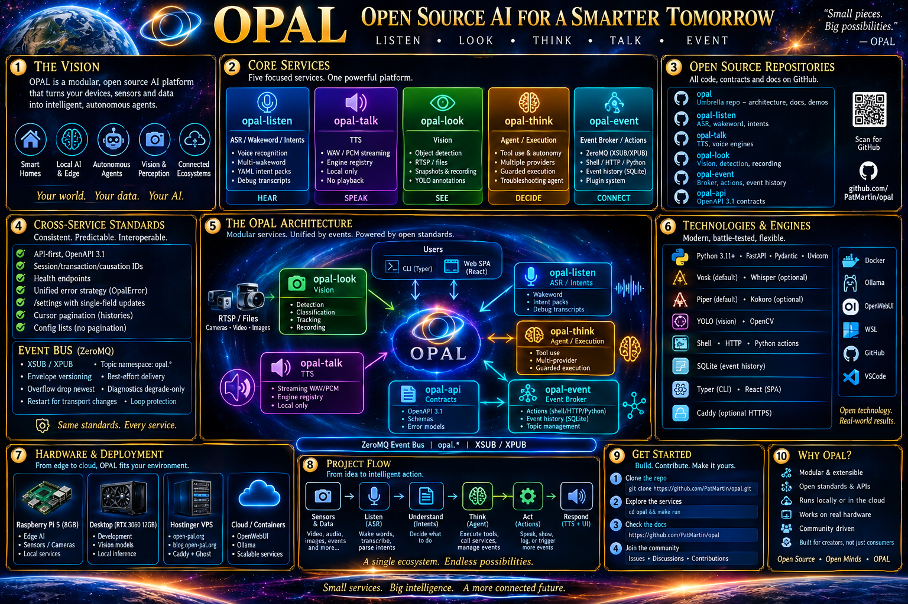

# OPAL — Open, Modular, Local-First AI Services



> **Listen. Talk. Look. Think. Act.**  Build an intelligent assistant by composing small, independently deployable, API-first services instead of accepting a single monolithic assistant, a particular model vendor, or a particular device.
>
> **Document scope:** architecture, philosophy, interfaces, contracts, deployment, operational behavior, command-line reference, end-to-end recipes, verification, and the future command surface. **Repository snapshot: 2026-10-29.** This is a comprehensive project-level README, not a replacement for each service's normative OpenAPI contract or its detailed CLI guide.

[Why OPAL?](#why-opal) · [Architecture](#the-architecture) · [Repository map](#repositories-and-implementation-status) · [Unified command tree](#the-unified-opal-command-tree) · [Installation](#getting-started) · [Listen CLI](#opal-listen--the-ears) · [Talk CLI](#opal-talk--the-voice) · [Event CLI](#opal-event--the-nervous-system) · [Look vision](#opal-look--the-eyes-planned) · [Think vision](#opal-think--the-brain-planned) · [Recipes](#cross-service-recipes) · [Contracts](#contracts-versioning-and-compatibility) · [Roadmap](#roadmap-and-known-gaps)

---

## Read this first: current implementation versus vision

OPAL is simultaneously **an architectural vision**, **a set of independently versioned API contracts**, and **working Python implementations**. Those are related, but they are not interchangeable. This README marks commands as follows:

- **`[LIVE]`** — implemented in the service repository and documented by its actual CLI, subject to installing and running that service and its dependencies.
- **`[DESIGN]`** — proposed in the umbrella `opal` documentation or the service design; **not currently executable**.
- **`[FUTURE]`** — a recommendation or extension beyond the current published implementation, deliberately separated from the audited interfaces.

The **large tree below is a unified *target* command tree**, deliberately combining the existing Listen/Talk/Event command hierarchies with the planned Look/Think hierarchies. It is not evidence that a unified installer, one executable, or every tree node exists today.

**Important packaging caveat:** the three currently implemented Python projects independently register a console script named `opal` in their `pyproject.toml`. Installing all three into a single Python environment can cause the last-installed distribution to overwrite the `opal` entry point. The `opal` umbrella repository is documentation-only today and does not provide a dispatcher package that unifies those entry points. Use separate environments, the standalone `opal-event` / `opal-talk` scripts where applicable, or an explicit wrapper you own until a real suite-level dispatcher is created. **Do not interpret `pip install -e` of all three services as a working unified CLI installer.** Listen's independently packaged CLI uses `opal listen ...` when its entry point is selected.

## Why OPAL?

Most assistant stacks bind everything together: the microphone handler knows the speech library; the intent handler knows the automation backend; the voice interface knows the TTS engine; vision is intertwined with model-specific data types; and the agent can perform side effects with little inspection or control. A replacement model, a new device, or a security boundary change then becomes a system-wide rewrite.

OPAL makes a different tradeoff. Each capability has a **small conceptual vocabulary**, a **stable HTTP contract**, an **implementation behind that contract**, and **multiple independent interfaces** to the same capabilities. Services communicate over the network and publish events. The pieces can live on a Raspberry Pi, on a local GPU server, in containers, or on different hosts.

### Ten governing principles

1. **API-first, not code-first.** Design and validate an OpenAPI 3.1 contract before implementation. Make interface changes explicit rather than incidental.
2. **Contract/API/CLI/GUI parity.** A feature should be callable over REST, scriptable from a Typer CLI, and available through the web UI where appropriate. CLI and UI clients do not bypass REST to mutate local internals.
3. **Engine independence.** The public nouns are *intents, voices, sources, models, agents, rules*, and similar OPAL abstractions — never vendor-specific command-line flags or proprietary Python types.
4. **Local-first and privacy-oriented.** Offline Vosk/Piper/Kokoro and LAN-hosted model inference are first-class choices. Hosted inference is an explicit optional provider choice, not the architecture's center.
5. **Small, replaceable services.** A Raspberry Pi should be able to capture audio while a GPU host performs expensive inference without pretending every node has identical resources.
6. **Events decouple producers from consumers.** New subscribers can be added without modifying wakeword, synthesis, or vision code. REST remains the control and query plane; ZeroMQ provides an event transport.
7. **Explicit resource bounds.** Audio buffers, execution queues, model caches, database retention, input sizes, and worker counts have limits. Overload must be visible, not infinite.
8. **Inspectable behavior.** Health endpoints, logs, failed utterances, performance histories, execution records, correlation IDs, and test/dry-run modes make the system explainable.
9. **Controlled mutations.** Strong ETags protect configuration; rules/actions can be tested before enabling; future agent side effects must be authorized independently of model intent.
10. **Mockable, testable implementations.** Fake providers, golden audio fixtures, contract checks, CLI-to-REST tests, integration tests and deterministic fixtures should be standard practice.

### Why separate sensory processing from reasoning?

A phrase such as “computer, turn on the kitchen lights” often needs **no LLM**: a cheap, deterministic wakeword/STT/intent pipeline is faster, works offline, and is easier to test. “Who is at the front door, and should I tell someone?” may require computer vision plus rules or an agent. “Explain the last ten detections” may require event history and a language model. OPAL uses the least complex component capable of the task rather than routing everything through a large model.

### What OPAL is not

OPAL is not a single model, a cloud SaaS, a required home-automation product, a guaranteed-delivery message queue, or permission for autonomous agents to execute arbitrary instructions. **Event v1 is best effort, not Kafka**; **Talk synthesizes audio but does not play it**; **Look is not face recognition by default**; **Think is not a privileged shell masquerading as an agent**. These boundaries are features.

---

## Repositories and implementation status

The following seven `PatMartin/opal*` repositories were enumerated and inspected on GitHub. The independent service repositories are the sources of truth for *implemented* behavior; the umbrella repository describes the broader design.

| Repository | Purpose | Source-observed state on 2026-10-29 | Key entry points |
|---|---|---|---|
| [`PatMartin/opal`](https://github.com/PatMartin/opal) | Suite narrative, conceptual user guide and unified CLI design | Documentation-only: `README.md`, `CLI.md`, `USER_GUIDE.md`, `why_opal.md`; no source package or bundled OpenAPI YAML in the current tree | [`CLI.md`](https://github.com/PatMartin/opal/blob/main/CLI.md) · [`why_opal.md`](https://github.com/PatMartin/opal/blob/main/why_opal.md) |
| [`PatMartin/opal-api`](https://github.com/PatMartin/opal-api) | Published central OpenAPI contracts and linters | Three published contracts, **all `info.version: 1.4.0`**: Event, Listen and Talk. No published Look/Think YAML in this repository. | [`openapi/`](https://github.com/PatMartin/opal-api/tree/main/openapi) · [`README`](https://github.com/PatMartin/opal-api/blob/main/README.md) |
| [`PatMartin/opal-listen`](https://github.com/PatMartin/opal-listen) | Offline wakeword + speech understanding, testing, diagnostics, events | Working FastAPI service/CLI and embedded static HTML UI; active local contract **1.3.0**; Python package version **0.1.0** | [`README`](https://github.com/PatMartin/opal-listen/blob/main/README.md) · [`CLI`](https://github.com/PatMartin/opal-listen/blob/main/docs/CLI.md) · [`QUICKSTART`](https://github.com/PatMartin/opal-listen/blob/main/docs/QUICKSTART.md) |
| [`PatMartin/opal-talk`](https://github.com/PatMartin/opal-talk) | Engine-neutral text-to-speech | Working FastAPI service, Typer CLI, React/Vite SPA; implementation and active contract **1.2.0** | [`README`](https://github.com/PatMartin/opal-talk/blob/main/README.md) · [`CLI`](https://github.com/PatMartin/opal-talk/blob/main/docs/CLI.md) · [`USER_GUIDE`](https://github.com/PatMartin/opal-talk/blob/main/docs/USER_GUIDE.md) |
| [`PatMartin/opal-event`](https://github.com/PatMartin/opal-event) | Best-effort XSUB/XPUB broker, rule engine and action runner | Working FastAPI service, Typer CLI, React/Vite SPA; implementation and local contract **1.2.0** | [`README`](https://github.com/PatMartin/opal-event/blob/main/README.md) · [`CLI`](https://github.com/PatMartin/opal-event/blob/main/docs/CLI.md) · [`ZeroMQ protocol`](https://github.com/PatMartin/opal-event/blob/main/specs/zeromq_protocol.md) |
| [`PatMartin/opal-look`](https://github.com/PatMartin/opal-look) | Future computer-vision service | Repository exists but currently contains **no committed files**; vision ideas appear in umbrella documentation | [Repository](https://github.com/PatMartin/opal-look) · [planned command outline](https://github.com/PatMartin/opal/blob/main/CLI.md) |
| [`PatMartin/opal-think`](https://github.com/PatMartin/opal-think) | Future LLM/agent runtime | Repository exists but currently contains **no committed files**; umbrella Think contract is expressly described as **incomplete/reconstructed** | [Repository](https://github.com/PatMartin/opal-think) · [planned command outline](https://github.com/PatMartin/opal/blob/main/CLI.md) |

**Version warning:** `opal-api` 1.4.0 should not be assumed runtime-compatible with the 1.2.0 Event/Talk implementations or the 1.3.0 Listen implementation merely because it is centrally published. Compare operation IDs, schemas, validation rules, responses, and tests before upgrading. The umbrella `opal/README.md` still describes a **v1.3.0 label/repackaging draft**, not a verified five-service rollout. Its references to five archived contracts do not mean those files are present in the current GitHub tree.

### What is implemented versus specified?

| Capability | Listen | Talk | Event | Look | Think |
|---|---:|---:|---:|---:|---:|
| FastAPI REST implementation | ✅ | ✅ | ✅ | — | — |
| Typer CLI | ✅ | ✅ | ✅ | Planned | Planned |
| Browser UI | ✅ static UI | ✅ React | ✅ React | Planned | Planned |
| Local SQLite state | ✅ | ✅ | ✅ | Planned | Planned |
| Engine/provider adapters | Vosk + optional refinement | Piper/Kokoro | action types | Proposed YOLO/etc. | Proposed Ollama/hosted |
| Live media pipeline | Microphone | PCM output | No media processing | Planned image/video | No media capture |
| ZeroMQ participation | Implemented publisher; opt-in for auto-publication | Integration via REST, not a primary broker | Broker + observer | Planned publisher | Planned orchestration |
| Production CLI command surface | ✅ | ✅ | ✅ | ❌ | ❌ |

---

## The architecture

### Five services, five responsibilities

```text
                       ┌────────────────────────────────────────────┐
                       │         CLI / SPA / Your applications      │
                       │         REST control + query plane         │
                       └───────┬─────────────┬───────────┬─────────┘
                               │             │           │
       microphones             │             │           │        cameras/RTSP/files
            │                  │             │           │               │
            ▼                  │             │           │               ▼
      ┌────────────┐           │             │           │         ┌────────────┐
      │ OPAL LISTEN│           │             │           │         │ OPAL LOOK  │
      │ wake / STT │           │             │           │         │ detect/OCR │
      │ NLU / slots│           │             │           │         │ sessions   │
      └─────┬──────┘           │             │           │         └──────┬─────┘
            │ events           │             │           │       events   │
            ▼                  ▼             ▼           ▼                ▼
      ┌────────────────────────────────────────────────────────────────────────┐
      │                   OPAL EVENT — the nervous system                      │
      │     XSUB/XPUB proxy  +  observer  +  rule matching  +  action pool      │
      │     REST ingress     +  SQLite histories  +  operational visibility    │
      └───────────┬──────────────────────────┬───────────────────┬────────────┘
                  │ subscriber/REST          │ tools/actions     │ notifications
                  ▼                          ▼                   ▼
          ┌─────────────┐              ┌──────────────┐     ┌─────────────┐
          │ OPAL THINK  │              │ shell / HTTP │     │ your apps   │
          │ LLM + agent │              │ / Python     │     │ & devices   │
          │ tools/memory│              └──────────────┘     └─────────────┘
          └──────┬──────┘
                 │ REST speech requests / agent-approved actions
                 ▼
          ┌─────────────┐
          │ OPAL TALK   │  ── WAV / PCM / progressive raw PCM ──▶ speakers/player
          │ Piper/Kokoro│     (playback belongs to caller/sink)
          └─────────────┘
```

**The drawing expresses intended composition.** Event, Listen, and Talk are working services; Look and Think are conceptual service slots. There is currently no built-in end-to-end assistant that implements the whole diagram. A client may coordinate calls directly, or an external Event action/agent can serve as glue.

### Control plane versus data plane

| Surface | Use it for | Do **not** assume |
|---|---|---|
| REST (`/api/v1/...`) | CRUD, configuration, synchronous operations, histories, health, media requests, agent/run management | That REST admission means an asynchronous side effect has finished |
| CLI (`opal <service> ...`) | Scriptable human interface to REST operations; local test and diagnostic commands | That every conceptual command is installed from one suite package |
| Web SPA | Inspect and manage service state through REST | That UI calls should bypass the contract or directly edit SQLite |
| ZeroMQ PUB/SUB | Asynchronous event delivery, loose coupling, live observations | Acknowledgment, transactional delivery, replay, global ordering, or exactly-once execution |
| SSE | A one-way stream of recognition or inference events | Bidirectional transport or universal replay semantics |
| Raw PCM / WAV / MJPEG | Media exchange and previews | That raw media belongs in JSON bus events |

### Deployment without a monolith

A representative distributed installation:

```text
Raspberry Pi 5 / edge                            Desktop / GPU / scalable containers
┌───────────────────────────────┐                 ┌────────────────────────────────────┐
│ Microphone → opal-listen      │                 │ opal-look (future) + YOLO GPU     │
│ opal-talk + Piper (optional)  │◀── REST / LAN ─▶│ opal-think (future) + Ollama/LLM  │
│ Local playback/automation     │                 │ Kokoro/large STT when needed       │
└──────────────┬────────────────┘                 └─────────────────┬──────────────────┘
               │                  trusted LAN                       │
               └──────────────────┬─────────────────────────────────┘
                                  ▼
                       opal-event XSUB / XPUB
                       (one well-known broker)
```

Run components separately during development. Use containers, service managers or a reverse proxy in production; select interfaces and ports intentionally. **Never expose an unauthenticated development endpoint or unencrypted event socket to an untrusted network.** Event and Talk examples default to loopback. Listen's current quick start explicitly reports binding to all interfaces; secure/restrict that binding for networked deployments instead of assuming every OPAL service is loopback-only.

### Standard ports from the current repositories

| Component | Example default | Notes |
|---|---|---|
| Listen HTTP | `:8000` | Current Listen README describes binding to host interfaces; verify before exposing |
| Talk HTTP | `127.0.0.1:8001` | `/docs`, optional `/ui` |
| Event HTTP | `127.0.0.1:8080` | API, health, operational control |
| Event incoming XSUB | `tcp://127.0.0.1:5555` | **Producers connect their PUB** sockets here |
| Event outgoing XPUB | `tcp://127.0.0.1:5556` | **Consumers connect their SUB** sockets here |
| Look/Think HTTP | Not implemented | Do not assign a production default that does not exist |

---

## Conceptual vocabulary

### Fundamental entities

| Entity | Meaning | Owned by |
|---|---|---|
| **Engine / provider** | A runtime implementation (Vosk, Piper, Kokoro, YOLO adapter, Ollama adapter) behind a stable interface | Listen/Talk/Look/Think |
| **Model** | A chosen inference artifact/identifier, along with capabilities and runtime requirements | Listen/Look/Think |
| **Wakeword** | Speech activation phrase and sensitivity threshold | Listen |
| **Utterance** | Spoken input after audio capture/endpoint detection | Listen |
| **Intent** | Deterministic semantic action label, such as `light_turn_on` | Listen |
| **Slot** | Typed value extracted from an utterance, e.g., `room_name=living_room` | Listen |
| **Alias** | Alternative spoken form mapping to a canonical slot value | Listen |
| **Profile** | Reusable group of settings: Listen recognition profile, Talk generation preset, Look analysis preset | Each applicable service |
| **Voice** | OPAL ID registered against an engine-native voice/model reference | Talk |
| **Source** | Named camera, file, stream or image/media input | Look (planned) |
| **Vision task** | Detection, classification, segmentation, pose, tracking, OCR | Look (planned) |
| **Session** | A service-local stateful task (e.g. video analysis); distinct from a correlation header | Look/Think (planned) |
| **Event** | Topic plus structured JSON data and optional metadata | Event, all publishers |
| **Rule** | Enabled topic pattern + AND conditions + one or more action IDs | Event |
| **Action** | Predefined shell, HTTP or Python handler that can be invoked with an event | Event |
| **Execution** | Auditable result of dispatching an action | Event |
| **Conversation** | Persisted multi-turn history | Think (planned) |
| **Agent** | A configured reasoning policy: model, instructions, allowed tools, memory, delegation | Think (planned) |
| **Run** | Auditable asynchronous agent workflow with steps and lifecycle | Think (planned) |
| **Tool** | Restricted agent capability for reading, computation or approved side effects | Think (planned) |
| **Memory** | Opt-in namespaced durable records separate from prompt context | Think (planned) |

### Tracing and causality

OPAL's correlation vocabulary differentiates four distinct concerns:

| Header | Purpose | Important limitation |
|---|---|---|
| `X-Opal-Session-Id` | Logical conversational/workflow context across calls | **Not** a session resource or authorization token |
| `X-Opal-Transaction-Id` | Logical end-to-end operation from intent through effects | **Not** an ACID transaction across services |
| `X-Opal-Request-Id` | One HTTP request/response exchange | New request ID on every HTTP hop |
| `X-Opal-Causation-Id` | Immediate triggering request/event | Parent relationship, not proof of trust |

Valid IDs are opaque printable ASCII tokens, ordinarily up to 128 characters; invalid client-supplied values should fail validation. Propagate transaction/session/cause through derived events, headers and traces. Generate a fresh request ID at each downstream HTTP request. The `metadata.schema_version` of an event envelope is **not** the REST API's `info.version`, nor the Python package version.

```text
User command
   transaction=txn-A, session=sess-7
  └─ Listen recognition: request=req-1
       └─ intent event: event=evt-10, cause=req-1
            └─ Event action: request=req-2, cause=evt-10
                 └─ Talk generation: request=req-3, cause=req-2
```

### Error handling and concurrency

The shared design prefers predictable HTTP behavior: `201 Created` with `Location`, `202 Accepted` for asynchronous admission, `204 No Content` for deletion, 4xx errors with machine-readable codes, and health indicators independent of command success. A common `OpalError` model is the target; **current contracts and implementation versions should be checked individually** rather than assuming all error shapes have already converged.

For mutable resources, clients should retrieve a strong ETag, apply a conditional update via `If-Match`, and handle `428 Precondition Required` and `412 Precondition Failed` by rereading and retrying *only after reconciling* the new state. Event's CLI can auto-fetch ETags when omitted for supported mutations. This is **optimistic concurrency**, not a global lock.

Growing histories use opaque cursors where supported (`items`, `next_cursor`, `has_more`); bounded configuration catalogs return whole lists. Changing filters invalidates a pagination cursor. Not all existing historical Listen endpoints have been migrated to exactly the same pagination convention; consult the live contract.

### Settings, backups, and change control

Configuration has three lifecycles:

1. **Service/host bootstrap configuration:** bind addresses, file paths, security material and engine resources. Often requires restart.
2. **Portable runtime settings and catalogs:** recognition phrases, voice registrations, Event rules/actions, approved settings. Changes are validated and applied through REST or service-specific import paths.
3. **Operational history:** audio logs, Event executions, observations, agent traces. **Not** a configuration backup.

Prefer *validate → inspect diff → backup → apply → verify*. Backups must exclude credentials and history unless there is an explicit separate protected backup process. Be careful: **Listen's import/restore logic supports protective backups and rollback; Talk's current CLI documentation says `backup import` and `backup restore` are immediately applied and do not automatically make a safety backup.** Follow each service's real semantics, not an idealized universal behavior.

---

## The unified OPAL command tree

> **THE OPAL VISION — one single master tree.** `[LIVE]` categories come from the current service CLI documents. `[DESIGN]` categories come from the umbrella OPAL design and are **not runnable**. A **real unified dispatcher remains future work** because `opal` console-script names currently collide across distributions. This tree expresses the desired stable user experience without falsifying implementation status.

```text
opal                                           # SUITE COMMAND NAMESPACE (VISION)
│
├── listen [LIVE]                             # Wakeword / recognition / intent engine
│   │   --api-url URL  --xpub URL  --xsub URL  --json  --timeout SECONDS
│   ├── wakewords
│   │   ├── list                              # All configured wakewords
│   │   ├── get NAME_OR_ID                    # One wakeword + threshold
│   │   ├── add NAME                          # Threshold / enabled state
│   │   ├── update NAME_OR_ID                 # Name / threshold / enabled
│   │   └── remove NAME_OR_ID
│   ├── intents
│   │   ├── list
│   │   ├── get NAME_OR_ID
│   │   ├── add NAME                           # --phrase, --description, --threshold
│   │   ├── update NAME_OR_ID
│   │   ├── remove NAME_OR_ID
│   │   ├── phrases NAME_OR_ID                 # List phrase templates
│   │   ├── add-phrase NAME_OR_ID PHRASE
│   │   └── remove-phrase NAME_OR_ID PHRASE_OR_ID
│   ├── slots
│   │   ├── list
│   │   ├── get NAME_OR_ID
│   │   ├── add NAME                           # list/number slot types
│   │   ├── update NAME_OR_ID
│   │   ├── remove NAME_OR_ID
│   │   ├── values SLOT                        # Canonical values
│   │   ├── add-value SLOT VALUE
│   │   ├── remove-value SLOT VALUE_OR_ID
│   │   ├── aliases SLOT VALUE
│   │   ├── add-alias SLOT VALUE ALIAS
│   │   └── remove-alias SLOT VALUE ALIAS
│   ├── profiles
│   │   ├── list
│   │   ├── get NAME_OR_ID
│   │   ├── add NAME                           # Wakewords/thresholds/VAD/intents/slots
│   │   ├── update NAME_OR_ID
│   │   ├── activate NAME_OR_ID
│   │   └── remove NAME_OR_ID
│   ├── settings
│   │   ├── list
│   │   └── set KEY VALUE
│   ├── test
│   │   ├── text TEXT                         # Deterministic NLU test
│   │   ├── audio WAV                         # Full file-recognition path
│   │   ├── listen                            # Live microphone results
│   │   ├── listen-debug                      # Levels/partials/VAD events
│   │   └── regression                        # Run stored tests
│   ├── pipeline
│   │   ├── start
│   │   ├── stop
│   │   └── status
│   ├── failed
│   │   ├── list                              # Unmatched utterances
│   │   ├── get ID
│   │   ├── add TEXT
│   │   ├── update ID
│   │   ├── remove ID
│   │   └── promote ID                        # Turn failure into a phrase (+ optional test)
│   ├── regression
│   │   ├── list
│   │   ├── get ID
│   │   ├── add NAME PHRASE
│   │   ├── update ID
│   │   └── remove ID
│   ├── logs
│   │   ├── list                              # Recognition history
│   │   ├── get ID
│   │   └── count
│   ├── perf
│   │   ├── last
│   │   ├── summary
│   │   └── history
│   ├── config
│   │   ├── validate
│   │   ├── backup
│   │   ├── backups
│   │   ├── download FILENAME
│   │   ├── restore FILENAME
│   │   ├── delete-backup FILENAME
│   │   ├── export
│   │   └── import
│   ├── system
│   │   ├── doctor
│   │   ├── devices
│   │   ├── live
│   │   ├── ready
│   │   ├── info
│   │   └── ping
│   └── event
│       └── publish TOPIC MESSAGE            # Direct ZeroMQ publisher helper
│
├── talk [LIVE]                               # Engine-neutral text-to-speech
│   │   --api-url URL  --json  --timeout SECONDS
│   ├── engines
│   │   ├── list                              # Discover built-ins and plugins
│   │   ├── get ENGINE_ID
│   │   ├── update ENGINE_ID                  # Enabled / engine-scope options
│   │   └── validate ENGINE_ID                # Installed dependencies/resources
│   ├── voices
│   │   ├── list                              # OPAL voice registrations
│   │   ├── get VOICE_ID
│   │   ├── add VOICE_ID                      # --name --engine --ref
│   │   ├── update VOICE_ID
│   │   ├── remove VOICE_ID                   # Does NOT remove model files
│   │   ├── validate VOICE_ID
│   │   └── test VOICE_ID
│   ├── profiles
│   │   ├── list
│   │   ├── get ID
│   │   ├── add NAME                          # --voice, --speed, --volume, etc.
│   │   ├── update ID
│   │   ├── remove ID
│   │   └── activate ID
│   ├── generate TEXT -o OUTPUT               # WAV/PCM; --stream raw progressive PCM
│   ├── settings
│   │   ├── list
│   │   ├── get KEY
│   │   ├── set KEY VALUE
│   │   └── delete KEY
│   ├── backup
│   │   ├── list
│   │   ├── create
│   │   ├── download FILENAME
│   │   ├── restore FILENAME
│   │   ├── delete FILENAME
│   │   ├── export
│   │   ├── import
│   │   └── validate
│   ├── health
│   ├── info
│   └── ping
│
├── event [LIVE]                              # Event broker, routing rules and effects
│   │   --api-url URL  --token TOKEN  --json  --timeout SECONDS
│   │   --opal-session-id ID  --opal-transaction-id ID  --opal-causation-id ID
│   ├── publish TOPIC                         # --data-json; 202 means admitted, not delivered
│   ├── list                                  # Event history --topic/--source/--cursor
│   ├── get EVENT_ID
│   ├── delete EVENT_ID
│   ├── clear                                 # Destructive event-history purge
│   ├── topics                                # Observed/known topics
│   ├── rules
│   │   ├── list
│   │   ├── get RULE_ID
│   │   ├── create                            # --json or --file
│   │   ├── update RULE_ID                    # --json/--file/--if-match
│   │   ├── delete RULE_ID                    # --if-match
│   │   └── test RULE_ID                      # --event-json, no side effects
│   ├── actions
│   │   ├── list
│   │   ├── get ACTION_ID
│   │   ├── create                            # Shell / HTTP / Python
│   │   ├── update ACTION_ID                  # --json/--file/--if-match
│   │   ├── delete ACTION_ID                  # --if-match
│   │   └── execute ACTION_ID                 # Explicit manual side effect
│   ├── executions
│   │   ├── list                              # Filter/cursor
│   │   └── get EXECUTION_ID
│   ├── settings
│   │   ├── get
│   │   └── update                            # --json/--file/--if-match
│   ├── backup
│   │   ├── export
│   │   ├── validate
│   │   └── import                            # Conditional atomic import
│   ├── health [--live | --ready]
│   └── stats
│
├── look [DESIGN — NOT IMPLEMENTED]           # Computer vision and video sessions
│   ├── engines
│   │   ├── list
│   │   ├── get ENGINE_ID
│   │   ├── update ENGINE_ID
│   │   └── validate ENGINE_ID
│   ├── models
│   │   ├── list
│   │   ├── get MODEL_ID
│   │   ├── add MODEL_ID
│   │   ├── update MODEL_ID
│   │   ├── remove MODEL_ID
│   │   └── validate MODEL_ID
│   ├── sources
│   │   ├── list
│   │   ├── get SOURCE_ID
│   │   ├── add SOURCE_ID
│   │   ├── update SOURCE_ID
│   │   ├── remove SOURCE_ID
│   │   └── validate SOURCE_ID
│   ├── profiles
│   │   ├── list
│   │   ├── get PROFILE_ID
│   │   ├── add PROFILE_ID
│   │   ├── update PROFILE_ID
│   │   ├── remove PROFILE_ID
│   │   ├── validate PROFILE_ID
│   │   └── activate PROFILE_ID
│   ├── media
│   │   ├── upload PATH
│   │   ├── list
│   │   ├── get MEDIA_ID
│   │   ├── download MEDIA_ID
│   │   └── remove MEDIA_ID
│   ├── analyze IMAGE_PATH                    # One-shot inference: model/task/confidence
│   ├── sessions
│   │   ├── start                             # Source + profile/model
│   │   ├── list
│   │   ├── get SESSION_ID
│   │   ├── stop SESSION_ID
│   │   ├── remove SESSION_ID
│   │   ├── latest SESSION_ID                # Latest structured result
│   │   ├── events SESSION_ID                # SSE stream / result events
│   │   └── preview SESSION_ID               # Annotated MJPEG preview
│   ├── results
│   │   ├── search
│   │   ├── get RESULT_ID
│   │   ├── remove RESULT_ID
│   │   └── snapshot RESULT_ID               # Request exact-frame JPEG
│   └── snapshots
│       ├── list
│       ├── get SNAPSHOT_ID
│       ├── download SNAPSHOT_ID
│       └── remove SNAPSHOT_ID
│
└── think [DESIGN — NOT IMPLEMENTED]          # Reasoning, agents, memory and tools
    ├── providers
    │   ├── list
    │   ├── get PROVIDER_ID
    │   ├── add PROVIDER_ID
    │   ├── update PROVIDER_ID
    │   └── remove PROVIDER_ID
    ├── models
    │   ├── list
    │   ├── get MODEL_ID
    │   ├── add MODEL_ID
    │   ├── update MODEL_ID
    │   └── remove MODEL_ID
    ├── generations
    │   └── create PROMPT                     # Stateless inference; optional stream
    ├── conversations
    │   ├── list
    │   ├── create
    │   ├── get CONVERSATION_ID
    │   ├── remove CONVERSATION_ID
    │   ├── messages CONVERSATION_ID
    │   └── respond CONVERSATION_ID TEXT     # Stateful turn
    ├── agents
    │   ├── list
    │   ├── get AGENT_ID
    │   ├── add AGENT_ID
    │   ├── update AGENT_ID
    │   └── remove AGENT_ID
    ├── runs
    │   ├── list
    │   ├── create AGENT_ID                   # Auditable agent execution
    │   ├── get RUN_ID
    │   ├── cancel RUN_ID
    │   └── events RUN_ID                     # SSE run trace
    ├── tools
    │   ├── list
    │   ├── get TOOL_ID
    │   ├── add TOOL_ID
    │   ├── update TOOL_ID
    │   └── remove TOOL_ID
    └── memory
        ├── list
        ├── get MEMORY_ID
        ├── set KEY VALUE
        ├── search QUERY
        └── remove MEMORY_ID
```

### Unified-dispatcher design target `[FUTURE]`

The user experience should ultimately be a single `opal` package hosting a Typer root app that registers independent service-specific subapps through entry points, while retaining existing standalone executables for compatibility. The dispatcher should be **a thin HTTP client**, not a dependency magnet importing PyTorch, Vosk or TTS runtimes. Service CLIs should be installable as lightweight optional client extras. Commands should have discoverable `--help`, `--json`, explicit `--api-url`/service endpoints, stable exit codes, completion, and minimal ambiguity over local versus server-side operations. Keep the hyphenated CLI option convention and `snake_case` in configuration and Python code.

---
## Getting started

### Prerequisites

The working services are Python 3.11+ projects. Listen needs a supported audio stack, an installed Vosk model for real recognition, and optionally `faster-whisper`; Talk needs installed voice/model assets for its Piper/Kokoro adapters; Event needs PyZMQ and a writable data/config directory. Node.js is needed to develop/build the Event and Talk React SPAs. The central API contract toolchain requires Node.js 20+ (CI uses Node 22).

On a recent Debian/Ubuntu host, the following system dependencies are a reasonable development starting point. Install only what your chosen services actually need:

```bash
sudo apt update
sudo apt install -y python3 python3-venv python3-dev build-essential \
  libasound2-dev portaudio19-dev libzmq3-dev ffmpeg sox git
```

Keep repositories as siblings:

```bash
mkdir -p ~/src/opal-suite
cd ~/src/opal-suite
for repo in opal opal-api opal-event opal-listen opal-talk opal-look opal-think; do
  git clone "https://github.com/PatMartin/${repo}.git"
done
```

**Note:** `opal-look` and `opal-think` are currently empty repositories. If they have no initial commit, Git may warn that you cloned an empty repository. This is expected, not an installation failure.

### A working service-by-service installation `[LIVE]`

**Keep each service in its own virtual environment** to avoid the `opal` entry-point collision and to avoid deploying heavy audio/model dependencies everywhere.

**OPAL Event — terminal A**

```bash
cd ~/src/opal-suite/opal-event
python3 -m venv .venv
.venv/bin/pip install -e '.[dev]'
cp config/opal_event.example.yaml config/opal_event.yaml
mkdir -p var
.venv/bin/opal-event-svc --config config/opal_event.yaml --log-level info
```

**OPAL Listen — terminal B**

```bash
cd ~/src/opal-suite/opal-listen
python3 -m venv .venv
.venv/bin/pip install -e '.[dev]'
export OPAL_LISTENER_VOSK_MODEL_PATH=/absolute/path/to/vosk-model-small-en-us-0.15
.venv/bin/python -m opal_listener
```

The model path is an example: download the Vosk model separately and point the environment variable to its extracted directory. Text-only tests can use the fake provider in automated testing, but production speech recognition requires a functioning provider/model. See the [Listen quick start](https://github.com/PatMartin/opal-listen/blob/main/docs/QUICKSTART.md) for Docker Compose, ALSA, model installation, and startup options.

**OPAL Talk — terminal C**

```bash
cd ~/src/opal-suite/opal-talk
python3 -m venv .venv
.venv/bin/pip install -e '.[engines,dev]'
# Install actual Piper/Kokoro model files separately; configure paths in config/service.yaml
.venv/bin/opal-talk-svc
```

In new terminal windows, invoke the *correct environment's CLI*:

```bash
# Event
~/src/opal-suite/opal-event/.venv/bin/opal-event health

# Listen; the Listen environment's `opal` entry point exposes `listen`
~/src/opal-suite/opal-listen/.venv/bin/opal listen system doctor

# Talk
~/src/opal-suite/opal-talk/.venv/bin/opal-talk health
```

Many subsequent examples show the aspirational common spelling, `opal event ...` / `opal talk ...` / `opal listen ...`, matching the service docs. Today, you can use `opal-event` and `opal-talk` as standalone alternatives, and call Listen's environment-owned `opal` binary. To prevent accidental calls to the wrong distribution, **check `command -v opal` and the output of `opal --help`**.

### Environment variables and API endpoints

```bash
# Target each running REST API; change hosts/ports as your actual topology requires.
export OPAL_EVENT_API_URL='http://127.0.0.1:8080'
export OPAL_TALK_API_URL='http://127.0.0.1:8001'
# Listen's REST endpoint can be overridden per command with --api-url.

# Event authentication is needed when the service is configured to require it.
# Export secrets in an appropriately protected process environment, not in git.
export OPAL_EVENT_API_TOKEN='replace-with-protected-secret'

# ZeroMQ event transport: publishers connect to 5555, subscribers connect to 5556.
export OPAL_EVENT_XPUB_URL='tcp://127.0.0.1:5555'  # Listen CLI legacy option name
export OPAL_EVENT_XSUB_URL='tcp://127.0.0.1:5556'  # Listen CLI legacy option name
```

**Naming trap:** Listen exposes `--xpub` for the URL its PUB socket connects to, but the underlying Event broker's **producer-facing socket is XSUB** (`:5555`). The names in Listen's CLI do not change the ZeroMQ topology. A consumer's SUB socket connects to the broker's **XPUB** (`:5556`).

### Verify that each process is healthy

```bash
# Standalone console scripts for Event/Talk:
opal-event health
opal-event health --ready
opal-talk health
opal-talk info

# In Listen's selected environment:
opal listen system ping
opal listen system info
opal listen system doctor
opal listen system devices
opal listen system live
opal listen system ready

# REST probes where enabled by the service implementation:
curl -i http://127.0.0.1:8080/api/v1/health/
curl -i http://127.0.0.1:8001/api/v1/health/
```

For Event and Talk, API reference is ordinarily visible at each service's `/docs` path. Listen's service also exposes `/docs`. Browser UI behavior differs: Talk serves a built SPA at `/ui`, Event's React SPA can run through Vite or be served separately, and Listen currently includes a static HTML UI rather than a separately packaged React app.

### Building the UI where it exists

```bash
# Event SPA: in a separate shell, after starting the Event REST service
cd ~/src/opal-suite/opal-event/spa
npm install
OPAL_EVENT_API_URL=http://127.0.0.1:8080 npm run dev

# Talk SPA: build and serve from the Talk service's configured spa_dir
cd ~/src/opal-suite/opal-talk/spa
npm install
npm run build
```

### Contract validation from the central repo

```bash
cd ~/src/opal-suite/opal-api
npm ci
npm run validate     # OpenAPI structure and reference resolution (Redocly)
npm run lint         # General Spectral rules
npm run lint:opal    # OPAL conventions: errors, headers, request context
npm run check        # All checks, same intent as CI
```

These checks validate **published YAML files**; they do not prove that a deployed runtime has upgraded to those contract versions. Runtime operation/response parity needs service-specific tests too.

---

## OPAL Listen — the ears

**Status: `[LIVE]`**, source: [`opal-listen`](https://github.com/PatMartin/opal-listen). **Concept:** convert low-level audio into structured, testable meaning, usually without an LLM. A microphone capture pipeline feeds VAD, optional wakeword detection, a speech provider, transcript normalization and intent/slot matching. A matched **live microphone** recognition may be published to Event when external publication is enabled. Diagnostics and tests should not accidentally cause physical actions.

### Pipeline and data model

```text
Microphone / WAV
    │  capture, resample/normalize, bounded buffering
    ▼
VAD + endpointing  ──────────────► discard silence/noise
    │
    ▼
Wakeword candidate ── confirmation ─► command active
    │
    ▼
Vosk grammar-constrained STT (or configured provider)
    │                     └── optional async Whisper refinement
    ▼
Utterance normalization
    ▼
Intent phrase/template match
    ├── literal words
    ├── [optional words]
    ├── (alternative | words)
    ├── {slot_name}: canonical value/alias/number
    └── confidence thresholds
    ▼
Recognition result ─────► SQLite logs / failed utterances / regression evidence
    │
    ├── SSE live diagnostics (local)
    └── optional, deduplicated live intent event ► OPAL Event
```

Typical model result:

```json
{
  "wakeword": "computer",
  "intent_name": "light_turn_on",
  "slot_values": { "room_name": "kitchen" }
}
```

The response above is **illustrative**, not a complete serialization of the real result schema. Consult the local OpenAPI spec for every field, match state, confidence score and error.

### Wakeword management `[LIVE]`

A wakeword is the explicit start of an actionable command in Mode 1. Keep multiple wakewords available, use meaningful thresholds, and test “almost wakewords” as negative cases.

```bash
opal listen wakewords list
opal listen wakewords get computer
opal listen wakewords add 'hey opal' --threshold 0.85
opal listen wakewords add nabu --threshold 0.70 --disabled
opal listen wakewords update nabu --threshold 0.95 --enabled
opal listen wakewords update 'hey opal' --name 'okay opal'
# Destructive; remove only when not referenced by a required profile:
opal listen wakewords remove nabu
```

The architecture uses a candidate/confirmation approach to reduce false positives such as a sound-alike word. In the current Listen 1.3.0 contract, a *pending* wakeword candidate must not produce a command outcome before confirmation.

### Intents and phrase templates `[LIVE]`

Intents are named actions, not arbitrary language-model interpretations. Phrase syntax:

```yaml
# Illustrative excerpt of actual seeded grammar
intents:
  - name: light_turn_on
    enabled: true
    confidence_threshold: 0.75
    phrases:
      - turn on [the] {room_name} (light | lights)
      - switch on [the] {room_name} (light | lights)
```

Square brackets express optional words, parentheses express alternatives, and braces refer to configured slots. A phrase generator can expand a compact template into many recognizer hypotheses while preserving canonical slot values.

```bash
opal listen intents list
opal listen intents get light_turn_on
opal listen intents add play_music \
  --description 'Start music playback' --threshold 0.75 \
  --phrase 'play [some] music' \
  --phrase '(start | put on) [some] music'
opal listen intents add light_dim \
  --description 'Dim a room' \
  --phrase 'dim [the] {room_name} (light | lights)'
opal listen intents add-phrase light_turn_on 'illuminate [the] {room_name}'
opal listen intents phrases light_turn_on
opal listen intents update play_music --name music_play
opal listen intents update cancel --threshold 0.9 --disabled
opal listen intents remove-phrase light_turn_on 'illuminate [the] {room_name}'
```

A phrase should be short and representative of a command you actually want to recognize. Requiring every wording variation to be enumerated manually is precisely what the template/slot/alias mechanism avoids. Distinguish between `no_wakeword`, `no_intent_matched`, low confidence, unfilled slots and actual provider failure when diagnosing misses.

### Slots and aliases `[LIVE]`

A slot is a typed captured variable. A list slot can hold values and aliases (`lounge` → `living_room`); a number slot can recognize an integer (`twenty one` → `21`). Aliases must be associated with canonical values and should avoid accidental ambiguity between commands.

```bash
opal listen slots list
opal listen slots get room_name
opal listen slots add color --type list
opal listen slots add-value color green --alias lime --alias emerald
opal listen slots values color
opal listen slots aliases room_name living_room
opal listen slots add-alias room_name living_room 'family room'
opal listen slots remove-alias room_name living_room 'family room'
opal listen slots remove-value color green
```

Check the live CLI's `slots add --help` for precise type flag/accepted values; this example is the conceptual sequence and the slot creation syntax may depend on the version installed. The **add-value/alias operations** above are documented in the current CLI.

### Recognition profiles and VAD `[LIVE]`

A profile bundles recognition tuning and an enabled vocabulary. Build a quiet-room profile with less aggressive VAD, or a noisy-room profile with more conservative thresholds. Profiles are a way to package validated operating modes, not to duplicate a pipeline per user.

```bash
opal listen profiles list
opal listen profiles get default
opal listen profiles add late_night \
  --description 'Quiet evenings' --activate \
  --wakeword computer \
  --threshold wakeword=0.85 \
  --vad silence_end_ms=900 --vad energy_threshold_dbfs=-50 \
  --intent light_turn_on --intent light_turn_off \
  --intent get_time --intent cancel \
  --slot room_name
opal listen profiles update late_night --vad silence_end_ms=1000
opal listen profiles activate default
opal listen profiles remove late_night
```

Important tuning knobs include `energy_threshold_dbfs`, `noise_margin_db`, end-of-speech silence, max utterance duration, wakeword threshold, STT threshold, intent threshold and model choice. Change one dimension at a time, record noise conditions and rerun positive/negative test sets.

### Test text, recorded audio, and microphone `[LIVE]`

```bash
# Fastest, deterministic NLU sanity checks:
opal listen test text 'computer, turn on the kitchen lights'
opal listen test text 'computer, switch on the lounge lights'
opal listen test text 'set the temperature to twenty one degrees'
opal listen test text 'start a ten minute timer' --expect-intent timer_set
opal listen test text 'order a pizza' --expect-intent no_match --no-save

# Exercise real STT (not just text matching):
opal listen test audio resources/cmds/cmd-kitchen-lights-on.wav --require-wakeword
opal listen test audio resources/cmds/cmd-cancel.wav --expect-intent cancel

# Capture your own 16-kHz mono test audio:
arecord -f S16_LE -r 16000 -c 1 -d 4 /tmp/opal-command.wav
opal listen test audio /tmp/opal-command.wav -v

# Live debugging (watch VAD, levels and partial recognition):
opal listen test listen --duration 30
opal listen test listen-debug --count 10 --duration 10 --start
```

**Critical safety distinction:** Listen 1.3.0 specifies that diagnostic `test text` and `test audio` results are locally evaluated/logged but **must not be published externally as actionable intent events**. Only qualified live microphone matches are eligible for publication, subject to enablement and deduplication. To simulate action routing, deliberately publish a separate test event with the Event CLI.

### Pipeline lifecycle and telemetry `[LIVE]`

```bash
opal listen pipeline status
opal listen pipeline start
opal listen test listen --no-start
opal listen perf last
opal listen perf summary
opal listen perf history
opal listen logs list
opal listen logs count
opal listen pipeline stop
opal listen system devices
opal listen system doctor
```

Measure microphone overruns, VAD decisions, recognition delays, STT latencies, refinement queue depth, match rate and successful publication. The 1.3.0 Listen contract adds metrics for dropped audio blocks, overflows, queued refinement, recovery counts and stage latencies. Model/pipeline failure should not crash diagnostic REST endpoints.

### The failed-utterance improvement loop `[LIVE]`

The learning loop is human-supervised and testable:

```text
Heard something → no recognized intent → failed utterance record
      ↓ inspect transcript and context
Create alias or phrase → promote failure → add regression case
      ↓
Rerun positive, negative and noise suites → compare performance
      ↓
Retain validated change or revert
```

```bash
opal listen failed list --unreviewed
opal listen failed list --not-promoted --limit 20
opal listen failed get 3
opal listen failed promote 3 --intent light_turn_on
opal listen failed update 5 --reviewed --notes 'TV in background'

opal listen regression add lounge_on 'switch on the lounge lights' \
  --expect-intent light_turn_on --slot room_name=living_room
opal listen regression add not_a_command 'order a pizza' \
  --expect-intent no_match
opal listen regression list
opal listen test regression
```

Promoting a failure to a phrase without a negative test can make recognition *worse* by introducing false positives. Maintain golden utterances, negatives and noisy-room fixtures. For voice assistants controlling physical systems, a false positive can be more costly than a prompt to repeat the command.

### Publication is intentionally opt-in `[LIVE]`

The seeded `opal_listener/config/settings.yaml` currently sets `event_publication_enabled: false`. Set it true only when you have a trusted downstream consumer and have validated the grammar:

```bash
opal listen settings list
opal listen settings set event_publication_enabled true
opal listen settings set dedup_window_ms 2000
opal listen pipeline status

# Controlled manual bus smoke test, independent of automatic recognition:
opal listen event publish opal.demo.test '{"message":"hello from Listen CLI"}'
```

The direct `event publish` helper wraps plain strings or JSON into a two-frame OPAL envelope. Listen's 1.3.0 contract disallows `event_transport=both` to avoid duplicate effects across parallel transports when there is no cross-transport deduplication. Publishing an event is **not** a delivery guarantee.

### Listen configuration, backup and recovery `[LIVE]`

```bash
opal listen config validate
opal listen config export
opal listen config backup
opal listen config backups
opal listen config download BACKUP_FILENAME
# Review the current state and take a fresh backup before destructive restore:
opal listen config restore BACKUP_FILENAME
opal listen config import
```

The main seed files under `opal_listener/config/` are `wakewords.yaml`, `intents.yaml`, `slots.yaml`, `profiles.yaml`, `stt.yaml` and `settings.yaml`. SQLite stores active state and recognition history; Alembic manages schema changes. The installed reference docs explain local config-file validation, YAML export modes, backup names and restore confirmations.

### Listen internals and extension points

The current source provides audio capture/resampling/VAD, Vosk provider support, a fake provider for tests, optional Whisper refinement, grammar/rule matching, a provider registry, settings persistence, failed-utterance review, regression records, ZeroMQ transport, HTTP events, a FastAPI API and embedded UI. `ListenerProvider` is a useful extension boundary: different recognizers should return a common result type and expose capability/configuration validation instead of leaking model-specific details into clients.

---

## OPAL Talk — the voice

**Status: `[LIVE]`**, source: [`opal-talk`](https://github.com/PatMartin/opal-talk). Talk is a **synthesis API**, not a media player. A caller chooses a registered voice or a profile, submits text, and receives WAV or raw PCM. Engine adapters select Piper/Kokoro; the core applies chunking, supported sample-rate conversion, volume and encoding.

### Core model

```text
Text request + optional profile/voice/portable controls
   │
   ├── Resolve active or explicit profile
   ├── Resolve registered OPAL voice → native engine voice reference
   ├── Merge effective engine options + validate capabilities
   ▼
TtsEngine adapter (Piper / Kokoro / plugin)
   │ synthesize chunks
   ▼
Core: chunking, resampling, gain, PCM/WAV encoding
   ├── POST /api/v1/generate          → completed WAV or raw PCM
   └── POST /api/v1/generate/stream   → progressive raw PCM
                                           │
                                           ▼
                                     caller-owned player/sink
```

**Engine** = synthesis runtime installed on the host. **Voice** = stable OPAL registration pointing at an engine-native resource. **Profile** = reusable speed/volume/format/voice preset. **Generation request** = a one-off operation optionally overriding selected defaults.

### Install voices and engines `[LIVE]`

Talk does not download Piper/Kokoro model assets, and registering a voice **does not upload, modify or remove** model files. For Piper, keep the `.onnx` file and corresponding `.onnx.json` together. For Kokoro, install the model and voice-bin assets and configure `model_path` / `voices_path`.

```bash
opal talk engines list
opal talk engines get piper
opal talk engines get kokoro
opal talk engines validate piper
opal talk engines validate kokoro

# Point the Piper adapter to the local directory containing ONNX voice files:
opal talk engines update piper -O voices_dir='"/home/me/piper/voices"'

# Register model references that exist on the service host:
opal talk voices add lessac \
  --name 'Lessac (medium)' --engine piper --ref en_US-lessac-medium
opal talk voices add kokoro-michael \
  --name 'Kokoro Michael' --engine kokoro --ref am_michael

opal talk voices list
opal talk voices list --engine kokoro
opal talk voices get lessac
opal talk voices validate lessac
opal talk voices test lessac
```

A voice registration's `engine_voice_ref` is engine-specific. Piper can resolve a model basename relative to the engine's `voices_dir`; Kokoro uses its voice name. A voice's `voice_id` remains stable even if its display name changes.

### Engine options versus portable controls

| Scope | Examples | Behavior |
|---|---|---|
| Engine configuration | Piper `voices_dir`, cache size; Kokoro model and voices asset paths | Applies to that adapter/host runtime |
| Voice registration | Engine/native reference, defaults, supported metadata | Logical catalog record, not uploaded model |
| Profile | Voice, speed, volume, sample rate, output format, engine options | Reusable preset, exactly one active |
| Generation request | Text, profile/voice override, speed, volume, output type, sample rate | Applies to this one output only |

The engine-specific `-O key=value` option parses values as JSON-like scalars; for example `-O noise_scale=0.4` is numeric while a string path may need nested quoting. **Unsupported options must fail rather than being silently ignored.** Engine option updates *merge*, but voice/profile engine-option updates *replace* the whole map; inspect the current object first.

```bash
# Merge one engine-wide option while retaining others:
opal talk engines update piper -O cache_size=8

# Replace the entire voice-specific option map:
opal talk voices update lessac -O noise_scale=0.4 -O noise_w_scale=0.6

# Clear all voice-level engine options:
opal talk voices update lessac --options-json '{}'
```

### Talk profiles `[LIVE]`

```bash
opal talk profiles list
opal talk profiles add main --voice lessac --active
opal talk profiles add calm --voice lessac --speed 0.9 --volume 0.8
opal talk profiles get 1
opal talk profiles activate 1

# Override the selected profile for an individual generation:
opal talk generate 'Welcome back.' --profile 1 -o welcome.wav
```

Use a profile for *stable product intent* (“house voice,” “telephony prompt,” “brief announcement”) instead of editing global settings whenever you want a different output. Profile identifiers may be numeric; refer to the actual IDs returned by your service.

### Complete WAV and raw PCM generation `[LIVE]`

```bash
# Completed WAV using the current active profile:
opal talk generate 'Hello from OPAL.' -o hello.wav

# Choose an explicit voice and common options:
opal talk generate 'Welcome to the workshop.' \
  --voice lessac --speed 1.10 --volume 0.80 \
  --sample-rate 16000 -o workshop.wav

# Completed raw PCM instead of a WAV container:
opal talk generate 'Testing raw PCM output.' \
  --format pcm --sample-rate 16000 -o /tmp/message.pcm

# Input from stdin is useful in scripts:
echo 'The build passed.' | opal talk generate - -o build-passed.wav
opal talk generate - -o chapter.wav < chapter.txt

# Listen to a completed file using your chosen audio player:
aplay hello.wav
```

Talk's raw PCM is **signed 16-bit little-endian, mono** (`s16le`). Its sample rate is reflected by the API's `X-Opal-Sample-Rate` header. If you play raw PCM at the wrong sample rate, the speed and pitch will be wrong. A completed WAV includes a container header; a progressive PCM stream does not.

### Progressive streaming `[LIVE]`

```bash
# Start listening before all sentences have been synthesized:
opal talk generate \
  'The first sentence can play while the rest of this announcement is generated.' \
  --stream --sample-rate 22050 -o - \
  | aplay -r 22050 -f S16_LE -c 1 -t raw

# Pipe to PipeWire/PulseAudio:
opal talk generate 'Pipeline check.' --stream --sample-rate 24000 -o - \
  | pacat --raw --rate=24000 --format=s16le --channels=1

# Or decode raw PCM through FFmpeg/ffplay:
opal talk generate 'Streaming output.' --stream --sample-rate 24000 -o - \
  | ffplay -autoexit -nodisp -f s16le -ar 24000 -ac 1 -i -

# Save raw streamed PCM, then wrap it in WAV:
opal talk generate 'Saved progressive stream.' \
  --stream --sample-rate 16000 -o /tmp/message.pcm
ffmpeg -f s16le -ar 16000 -ac 1 -i /tmp/message.pcm /tmp/message.wav
```

**Streaming is synchronous to the caller**, even though bytes arrive progressively. Streaming does not create a persistent job. The CLI's `--stream` path is raw PCM, not a partial WAV. Reduce `chunk_max_chars` to improve first-byte latency, while measuring continuity and total time; tiny chunks are not always better.

### Built-in engines and extension pattern

Piper is attractive for low-resource edge nodes; Kokoro is useful for higher-fidelity voices when the host has suitable compute. Both adapters ship in the current source. Third-party TTS adapters implement the documented `TtsEngine` interface (`availability`, `describe_voice`, `synthesize`, `option_specs`) and can be registered with `opal_talk.engines` Python entry points. Keep engine-specific options opaque and report supported capabilities; *the public API should not change just because an adapter changes*.

### Talk settings, backups and health `[LIVE]`

```bash
opal talk settings list
opal talk settings get chunk_max_chars
opal talk settings set max_text_chars 100000
opal talk settings set chunk_max_chars 200
opal talk settings set default_speed 1.1
opal talk settings set default_output_format wav

opal talk backup validate
opal talk backup create
opal talk backup list
opal talk backup export
opal talk health
opal talk info
opal talk ping
```

**Backup caution:** current Talk documentation says `backup restore` and `backup import` operate without automatic safety backups. Make a backup yourself immediately beforehand; preserve exported YAML in version control while keeping model binaries and secrets out of git. Also remember that deleting a voice registration does not delete the underlying `.onnx` assets.

### Example REST call `[LIVE]`

```bash
# Generate a completed audio response directly over HTTP.
# Use a voice/profile known to exist in your instance.
curl -fsS -X POST 'http://127.0.0.1:8001/api/v1/generate' \
  -H 'Content-Type: application/json' \
  -d '{"text":"Hello from REST.","voice_id":"lessac","output_format":"wav"}' \
  -o /tmp/rest-hello.wav
```

The precise request schema and required/optional fields are defined in the service's active `opal_talk.yaml`; test your request against `/docs` and its current contract before embedding it in production code.

---

## OPAL Event — the nervous system

**Status: `[LIVE]`**, source: [`opal-event`](https://github.com/PatMartin/opal-event). Event is simultaneously a **broker**, an **observer/persistence layer**, a **rule evaluator**, and a **bounded action executor**. It is not a general distributed transaction processor.

### The four responsibilities must remain separate

```text
HTTP POST /api/v1/events/ ──► service-owned PUB ─┐
                                                  ▼
external publishers (PUB) ────────────────────── XSUB (:5555)
                                                  │
                                       transparent ZeroMQ proxy
                                                  │
                                                  ▼
                                                XPUB (:5556) ──► external SUB clients
                                                  │
                                                  └──► internal SUB observer
                                                          │
                                           validate / normalize / persist
                                                          │
                                             topic + AND conditions
                                                          │
                                                bounded action queue
                                                          │
                                      shell / HTTP / Python subprocesses
                                                          │
                                                execution history/metrics
```

REST ingress enters the same XSUB pipeline as direct ZeroMQ publishers. The proxy forwards opaque messages and is not a validator. The **observer** performs normalization, validation, history persistence and rule processing. **A `202 Accepted` response means accepted for local handoff, not delivered to subscribers, persisted or executed.**

### Event wire contract

Every ZeroMQ message has **exactly two frames**:

```text
frame 1: opal.listen.intent.match
frame 2: {"topic":"opal.listen.intent.match", "source":"opal-listen", "data":{"intent_name":"light_turn_on"}}
```

Minimal envelope keys: `topic` and `data`; optional `id`, `source`, `timestamp`. Listen may include a `data.metadata` object carrying schema version/correlation context. The topic is ASCII lower-case dot-separated (`^[a-z][a-z0-9_-]*(\.[a-z][a-z0-9_-]*)*$`), at most 255 characters. The combined frames cannot exceed **1,048,576 bytes**.

- The JSON envelope's `topic` **must equal** frame 1.
- Send structured **references to media**, not raw images or audio inside event payloads.
- Prefer producer-supplied stable `id` and timestamp if a downstream application needs to correlate retries.
- Direct ZeroMQ publishers are not automatically normalized before the proxy forwards them; every external subscriber should validate what it receives.
- ZeroMQ SUB filtering uses a **raw byte prefix**; subscribing to `opal.look.` is different from an application rule using `opal.look.*`.
- Rules match exact topics or a suffix-`.*` hierarchical prefix; `vision.*` matches `vision.person` but not bare `vision` or `visionary`.
- There are **no durable queues, acknowledgments, replay, retry guarantees, exactly-once semantics or cross-publisher global ordering** in v1.

### Topics and naming

Favor a namespace owned by the producer:

| Topic | Intended meaning | Status |
|---|---|---|
| `opal.listen.intent.match` | Qualified live intent recognition | Implemented Listen publication topic |
| `opal.look.detection` / `opal.look.session.*` | Vision results/session lifecycle | Proposed naming only; finalize actual catalog in Look contract |
| `opal.think.run.*` | Agent run events, policy decisions, completed tasks | Proposed naming only; finalize actual catalog in Think contract |
| `opal.demo.test` | Manual smoke test | Arbitrary valid event topic |
| `vision.object.detected` | Detection example in current Event samples | Existing examples, not a requirement that Look publish this exact topic |

The README deliberately distinguishes **example event topics** from normative cross-service event catalogs. Adopt a versioned catalog and explicit schemas before standardizing automated consumers.

### Publishing events `[LIVE]`

```bash
# The command sends REST ingress to Event's configured HTTP endpoint:
opal event publish vision.object.detected \
  --data-json '{"object":"person","camera":"front_door","confidence":0.94}'

opal event publish sensor.temperature.reading \
  --data-json '{"room":"living_room","celsius":21.5}' \
  --source sensor-node-01

# Attach correlation context for an integrated workflow:
opal event --opal-session-id sess-7 --opal-transaction-id txn-voice-42 \
  publish opal.demo.test --data-json '{"kind":"integration_test"}'
```

Be careful with flags: `--json` placed immediately after `opal event` means **JSON output**; `--data-json` on `publish` means the **event payload**. Likewise `--json` on `rules create` and `actions create` is the JSON resource body, not the global output flag.

### History, topics, and inspection `[LIVE]`

```bash
opal event topics
opal event list
opal event list --topic vision.object.detected --limit 20
opal event list --source sensor-node-01
opal event get EVENT_UUID
opal event executions list
opal event executions list --status failed
opal event executions list --action-id announce_person --limit 20
opal event executions get EXECUTION_UUID
opal event stats
```

Event history is **for inspection, not replay**. `persistence.event_mode` determines which events are stored (`all`, `matched`, `none`); execution history is independently controlled. The sample defaults are 7-day retention, four execution workers, queue size 100 and an execution timeout of 30 seconds. Dropped work is visible as `status=dropped`, commonly `error_code=queue_full`, with no automatic retry.

### Rules: exact/prefix topics plus AND conditions `[LIVE]`

A rule has an ID, enabled flag, topic pattern, zero or more typed conditions and action IDs. Supported documented condition operators include `eq`, `ne`, `gt`, `gte`, `lt`, `lte`, `in`, `not_in`, `exists`, and `contains`. Strict JSON typing matters; `25` is not automatically interchangeable with the string `"25"`.

```json
{
  "id": "front_door_alert",
  "enabled": true,
  "topic": "vision.*",
  "conditions": [
    {"path":"data.object", "operator":"eq", "value":"person"},
    {"path":"data.confidence", "operator":"gte", "value":0.8}
  ],
  "actions": ["announce_person"]
}
```

```bash
opal event rules list
opal event rules get front_door_alert

# Use a JSON file to make code review and quoting easier:
opal event rules create --file ./front-door-rule.json

# Evaluate without executing any action:
opal event rules test front_door_alert --event-json '{
  "topic":"vision.object.detected",
  "data":{"object":"person","camera":"front_door","confidence":0.94}
}'

# Disable before revising a potentially impactful automation:
opal event rules update front_door_alert --json '{"enabled":false}'
```

With `opal event rules test`, inspect each `checks[]` entry to understand why a topic or condition matched. Test with a negative event too (e.g., confidence under threshold or a different object class). There is no need to execute a shell command merely to validate a predicate.

### Action types and execution safety `[LIVE]`

| Type | Configuration approach | Safety boundary |
|---|---|---|
| `shell` | Preconfigured executable + argv or explicit interpreter/script mode | Keep executable/script static; pass event data as data arguments, **not** constructed shell source |
| `http` | Configured method, URL, headers, body mode | Enforced host/scheme/port allowlist, DNS checks, redirects disabled; guard against SSRF |
| `python` | Allowlisted importable module and function | Separate process; JSON on stdin/stdout; timeout/output limits; **not** a strong sandbox against malicious code |

Safe example action to print a camera name:

```json
{
  "id": "announce_person",
  "type": "shell",
  "enabled": true,
  "mode": "exec",
  "executable": "/bin/echo",
  "args": ["person detected at {{data.camera}}"],
  "stdin": "none",
  "timeout_seconds": 10
}
```

```bash
opal event actions create --file ./announce-person-action.json
opal event actions list
opal event actions get announce_person

# Intentionally perform an action (unlike 'rules test'):
opal event actions execute announce_person --event-json '{
  "topic":"manual.test", "data":{"camera":"front_door"}
}'

opal event executions list --action-id announce_person
```

Templates are deliberately restricted: `{{data.path}}` and `{{event}}`, with no arbitrary expression evaluation. A placeholder alone can retain the JSON type; a placeholder embedded in text becomes a string. Missing paths are errors, not silently guessed values. A shell command that interpolates untrusted event data into executable code bypasses this important safety model — do not do that.

### Manual execution versus rule dispatch

A manual action execution checks the configured action and invokes it without first matching an Event rule. A published event goes through the broker and observer, is compared against enabled rules, and may enqueue *multiple independent* action executions. Their completion order is not guaranteed; either may fail while another succeeds. There is no rollback transaction encompassing all actions.

### Settings, concurrent updates, backups `[LIVE]`

```bash
opal event settings get
opal event settings update --json '{"execution":{"max_workers":4,"queue_size":100}}'

# Back up portable config to a file:
opal event backup export --output /tmp/opal-event-config.json

# Validate an import before applying it:
opal event backup validate --file /tmp/opal-event-config.json

# Import with revision protection (inspect the bundle first):
# opal event backup import --file /tmp/import-request.json

opal event health
opal event health --live
opal event health --ready
opal event stats
```

The settings update above is **illustrative and must be checked against the running version's portable-settings schema**; server bootstrap parameters such as bind addresses, CURVE keys, token and database path are not exposed by the portable settings API. REST mutation uses strong ETags; the Event CLI can fetch the current ETag automatically for supported operations or accept `--if-match` explicitly.

### Hot reload versus restart

The sample Event YAML includes `server`, `zeromq`, `security`, `execution`, `persistence`, `actions`, and `rules`. Live changes include rules/actions, worker policy and applicable retention settings. Changing network listener addresses, authentication, CURVE keys or SQLite database location requires a restart; health should expose a pending-restart state. File watching must validate changes before replacing last-known-good runtime state. Running executions keep their admitted configuration snapshot.

### Example publisher and subscriber (PyZMQ) `[LIVE protocol]`

```python
# publish.py: connect PUB to Event's XSUB (incoming :5555)
import json
import time
import uuid
from datetime import datetime, timezone
import zmq

context = zmq.Context.instance()
publisher = context.socket(zmq.PUB)
publisher.connect("tcp://127.0.0.1:5555")
time.sleep(0.3)  # demo slow-joiner mitigation; NOT a delivery guarantee

topic = "opal.demo.sensor"
message = {
    "id": str(uuid.uuid4()),
    "topic": topic,
    "source": "demo-python",
    "timestamp": datetime.now(timezone.utc).isoformat(),
    "data": {"celsius": 22.5, "device_id": "sensor-1"},
}
publisher.send_multipart([topic.encode("utf-8"), json.dumps(message).encode("utf-8")])
publisher.close()
```

```python
# subscribe.py: connect SUB to Event's XPUB (outgoing :5556)
import json
import zmq

context = zmq.Context.instance()
subscriber = context.socket(zmq.SUB)
subscriber.connect("tcp://127.0.0.1:5556")
subscriber.setsockopt(zmq.SUBSCRIBE, b"opal.demo.")

while True:
    frames = subscriber.recv_multipart()
    if len(frames) != 2:
        continue
    topic_bytes, body = frames
    try:
        event = json.loads(body)
    except (ValueError, UnicodeDecodeError):
        continue
    topic = topic_bytes.decode("utf-8", errors="replace")
    if not isinstance(event, dict) or event.get("topic") != topic:
        continue
    print(topic, event.get("data"))
```

Start the subscriber **before** the publisher. A PUB socket that connects immediately before sending can lose its first message while subscriptions propagate. Production systems should reconnect gracefully and explicitly choose how to tolerate missed events.

### Durable workflows need something other than PUB/SUB

Use Event for live telemetry, notifications and best-effort triggers. For a payment, deletion, device unlock, safety critical action or job that must definitely occur, add an external durable queue/outbox plus consumer acknowledgment, idempotency, authorization and reconciliation — **not** a false claim that Event v1 guarantees completion. Document that reliability boundary in every integration.

---
## OPAL Look — the eyes (planned)

**Status: `[DESIGN]` — repository is empty.** The umbrella OPAL documents describe a **model-neutral vision service**. No current Look executable, running API, CLI, container, or checked-in Look contract can be verified from `PatMartin/opal-look`; examples in this section express **desired behavior**, not installed functionality.

### Why a separate vision service?

Camera acquisition, frame decoding, inference and annotation need not live in a conversational agent. Look should expose a stable representation of a frame's objects and geometry regardless of whether the underlying engine is Ultralytics YOLO, ONNX Runtime, TensorRT, OpenCV, a CPU edge detector or a remotely hosted inference worker.

A stable Look API is useful for monitoring a driveway, counting objects, scene indexing, animal detection, package detection and robotic perception. It should not require the client to know how models represent boxes, masks, scores or tensors.

### Planned abstractions

| Concept | Meaning | Intended operations |
|---|---|---|
| Engine | A detector/classifier runtime and its capabilities | Discover, inspect, validate, configure |
| Model | An engine-specific model resource, known classes, task and runtime requirements | Register, list, get, validate, enable |
| Source | A camera, RTSP stream, HTTP/MJPEG feed, local file or uploaded media handle | Register, validate, inspect, remove |
| Task | Detection, classification, segmentation, pose, OCR, optional tracking | Declare supported capabilities, reject unsupported combinations |
| Profile | Reusable analysis defaults (model, confidence, frame rate, task, output) | Create, validate, activate, override |
| Analyze | One synchronous one-shot inference result | Submit image, receive normalized result |
| Session | A controlled continuous analysis pipeline | Start, stop, inspect, monitor, stream results |
| Result | Structured prediction tied to a frame/model/source/time | Search, retrieve, retain, expire |
| Snapshot | Explicitly requested exact-frame image artifact | Capture from retained frame, download, delete |
| Recording | Explicit, bounded capture of source/annotated output | Future opt-in session capability, quotas and retention |

### Intended media pipeline

```text
USB/Pi camera ─┐
RTSP stream ───┼─► Source adapter / decoder ─► frame ring buffer ─► scheduling
Video file ───┤                                                  │
Uploaded image─┘                                                  ▼
                                                         Engine + registered model
                                                                  │
                                         ┌────────────────────────┼──────────────────┐
                                         ▼                        ▼                  ▼
                                 normalized result          annotations      optional tracking
                                         │                        │                  │
                                         ├── REST result          ├── MJPEG preview  └── temporary IDs
                                         ├── SSE events           ├── exact-frame JPEG
                                         ├── optional opal.look.* event
                                         └── bounded persistence/retention
```

### Output invariants

A model-specific detection result should become a model-independent record. The umbrella Look design emphasizes: origin-corrected coordinates in the **original frame**, not the network's resized tensor; normalized boxes and keypoints; documented row-major RLE for masks; per-class confidence scores; source ID, frame ID, timestamp, model/version and session ID; exact-frame snapshots that fail if the requested frame has already expired instead of silently returning a newer image.

Classification, instance and semantic segmentation, pose and OCR are **design goals**, not claims of implemented MVP coverage. A sensible MVP starts with *single-class detection* and a narrow YOLO adapter, then expands in tested increments without changing the contract vocabulary.

### Continuous sessions, concurrency and backpressure

The model anticipates one-shot `analyze` and long-lived sessions. Multiple sessions may share one source. For bounded edge devices, design explicit limits for source count, concurrent decoders, pending frames, inference tasks, disk writes, snapshot buffers, uploads, video capture and GPU memory. Document whether overflow drops the newest frame, the oldest frame, or backpressures a producer. Require health reports to expose degraded sources and overloaded queues, not merely a green HTTP probe.

### Privacy and recording

The original vision emphasizes **no identity recognition by default** and **no automatic video recording**. Example retention targets from umbrella docs: observation history around 7 days and uploaded media around 24 hours; these are targets until a service enforces them. A future **opt-in recording** capability should define duration/size quotas, source/annotation output modes, cancellation, retention and privacy controls before implementation. Temporary tracking IDs should remain scoped to a session, not become persistent person identifiers.

### Proposed CLI examples `[DESIGN — NOT EXECUTABLE]`

```bash
# These examples are design sketches, not installed commands.
opal look engines list
opal look models list
opal look sources add front_door --type rtsp --uri 'rtsp://camera.example/stream'
opal look sources validate front_door
opal look profiles add people --model yolo-person --task detection

# One image or a continuous camera session:
opal look analyze ./frame.jpg --task detection --model yolo-person
opal look sessions start --source front_door --profile people
opal look sessions list
opal look sessions latest SESSION_ID
opal look sessions events SESSION_ID
opal look sessions preview SESSION_ID

# Historical evidence and explicit retained frames:
opal look results search --session SESSION_ID --label person
opal look results snapshot RESULT_ID
opal look snapshots download SNAPSHOT_ID -o exact-frame.jpg
opal look sessions stop SESSION_ID
```

The exact `sources add`, `profiles add` and related flags are **not standardized by a present implementation**. Treat these as vocabulary and intended discoverability; determine argument names in a reviewed Look contract before generating a CLI.

### Look integration with Event

Look should publish small, validated observations such as a result ID, session/source ID, class label and confidence. Consumers can resolve richer structured results or snapshots through REST on demand. Zone crossing, event aggregation, notification rules and home-automation actions belong in Event or a higher-level policy consumer, **not hardcoded into the detector**. A new model should not require editing home-automation code.

---

## OPAL Think — the brain (planned)

**Status: `[DESIGN]` — repository is empty and the historical Think contract is explicitly incomplete.** This section lays out the intended reasoning architecture, with a **separately labeled next-generation guarded agent concept**. No Think command below is currently runnable.

### Why Think must remain independent

Reasoning engines evolve quickly; an OPAL application should be able to switch between a local Ollama server, a specialized local model, an OpenAI-compatible inference API, a hosted model provider, or an agent framework without rewriting audio, events, tools and user interfaces. Think exposes consistent **models/providers**, **generations**, **conversations**, **agents**, **runs**, **tools** and **memory**. It does **not** capture microphones or cameras or play audio.

### Four layers of inference

| Layer | Persistence | Tools | Operational intent |
|---|---|---|---|
| **Generation** | Stateless request/response | None by default | Classification, summarization, transformation, analysis |
| **Conversation** | Message history | Optional by explicit future contract | Multi-turn user dialogue with a chosen model |
| **Agent** | Reusable definition | Explicit allowlist and policy | Goal-oriented reasoning with constrained capabilities |
| **Run** | Auditable lifecycle, steps, usage and output | Governed tool calls and delegation | Long-running or asynchronous agent workflow with trace/cancel |

A model is not an agent. A conversation is not necessarily a tool-using agent. A run is not simply a blocking text-generation call. Preserve these distinctions so simple inference stays inexpensive, testable and side-effect-free.

### Providers, models and adapters

Proposed adapter choices include a local **Ollama** provider, OpenAI-compatible HTTP endpoints, hosted providers, and higher-level runtimes such as Google ADK or LiteLLM. None should be a hard wire dependency. Each registered model should declare context limits, tool-use support, structured-output support, streaming ability, image/audio capabilities when applicable, and invocation constraints. Validate features at request time: unsupported inputs should produce a clear error, not a silently reduced answer.

An adapter should normalize streaming deltas, tool-call arguments, final responses, usage accounting, model errors, cancellation and timeouts. Handle partial failure and provider disconnection explicitly. Keep credentials in protected secret references/environment, not exported configuration bundles or model messages.

### Planned agent/tool policy model

```text
User/API goal
  ▼
Choose agent + model + bounded budget
  ▼
Plan → propose tool call / child delegation
  │
  ├── policy check: is capability registered and enabled?
  ├── policy check: is this agent permitted to call it?
  ├── policy check: arguments/scope/target allowed?
  ├── policy check: depth/loop/budget/time/token limits satisfied?
  ├── policy check: is approval required for a mutation?
  │
  ├── DENY → explicit trace entry, no execution
  └── ALLOW → execute through the allowed adapter / Event action
                       │
                       └── return structured result to run trace
  ▼
Verify state / decide to continue, delegate, finish or cancel
  ▼
Persist trace and response; publish lifecycle events if enabled
```

**Autonomous reasoning must not imply unlimited authorization.** A model can decide **which authorized tools** to use, in which order, and when to stop; it cannot acquire permission by writing instructions to itself. Run-time server policy is evaluated **for every tool call and every delegation**, not merely once when the agent definition is saved. Denied operations fail closed and remain auditable. Event independently enforces destination allowlists, execution controls and audit records for its own actions.

### Conversations, memory and context

Conversation history is a user-facing timeline. The model's *context window* is a transient, bounded selection from that timeline; trimming the context should not erase the stored conversation. Memory is a separate **opt-in, namespaced store** (service/agent/conversation), with explicit search, retention, provenance and deletion policies. Do not leak data between tenants, users, profiles or unrelated agents because a model happened to request it.

### Runs, budgets and delegation

Run objects should expose queued/running/completed/failed/cancelled states, step traces, model usage, tool input/output summaries, errors and timestamps. Multi-agent delegation must have explicit allowed child agents, a bounded depth and a **shared budget** so a parent cannot avoid limits by spawning children. Loop protection is needed at both agent-planning and Event-action layers; repeated tool arguments, repeated causation paths and excessive event depth should lead to a safe stop.

### Guarded autonomous systems troubleshooting `[FUTURE — DESIGN PROPOSAL]`

A high-value future Think agent is a **systems troubleshooting copilot** that uses progressive discovery instead of guessing. The design sequence is:

```text
OBSERVE current state (read-only)
   ↓
DIAGNOSE symptoms and generate competing hypotheses
   ↓
COLLECT targeted evidence, revise probabilities and plan
   ↓
SIMULATE changes (dry-run package manager, planned diff, impact)
   ↓
EVALUATE safety: privileges, data loss, service outage, rollback
   ↓
REQUEST APPROVAL before privileged or destructive mutations
   ↓
EXECUTE one approved, bounded step
   ↓
VERIFY expected outcome and unintended side effects
   ├── success → record evidence and finish
   └── failure → rollback or revise hypothesis and iterate
```

This is particularly relevant to Linux/Ubuntu service recovery, GPU drivers, package management and deployments. **Dry-run output is evidence, not authorization**. Prefer immutable audit records containing observation, hypothesis, proposed command, expected effect, risk category, approval, actual result and verification. Set a strict maximum number of iterations and avoid executing a self-generated shell string in a privileged environment. Actual system administration tools should live behind their own allowlists/approval rules and be invoked as structured operations, not arbitrary unrestricted terminal access.

### Human approvals and safety categories `[FUTURE]`

| Class | Example | Recommended behavior |
|---|---|---|
| Read-only | Inspect service health, list GPU driver modules, query package versions | Permit to approved agent; log results |
| Simulated | `apt-get -s`, config diff, proposed migration validation | Permit where safe; report uncertainty |
| Reversible low-impact | Restart a noncritical development service | Allow only under explicitly delegated policy; verify |
| Privileged mutation | Install/remove packages, change firewall, modify systemd | Explicit informed approval and checkpoint |
| Destructive/high-impact | Delete data, alter network route, disable security, flash firmware | Deny by default; stronger approval and recovery plan |

The original OPAL Think vision permits autonomous *tool use*, but these approval gates should be enforced in the service's tools/policy layer, not left to a system prompt or a model's promises.

### Proposed Think commands `[DESIGN — NOT EXECUTABLE]`

```bash
# Provider- and model-neutral operations:
opal think providers list
opal think providers add local-ollama --url http://127.0.0.1:11434
opal think models list
opal think models add local-coder --provider local-ollama --ref MODEL_NAME

# Isolated generation versus durable conversation:
opal think generations create 'Summarize this diagnostic trace.' --model local-coder
opal think conversations create
opal think conversations respond CONVERSATION_ID 'What happened since yesterday?'
opal think conversations messages CONVERSATION_ID

# Registered agents, tools, workflows and memory:
opal think tools list
opal think agents add diag_agent --instructions 'Observe and propose, never mutate without approval'
opal think runs create diag_agent --input 'Investigate service errors'
opal think runs events RUN_ID
opal think runs cancel RUN_ID
opal think memory search 'last successful service configuration'
```

The flag signatures above are **examples of intended UX**, not vetted CLI syntax. Ollama's models need not be local to the Think process; they may be reachable over a protected LAN. A future OpenAI/ChatGPT integration would be a **configured external provider or explicitly authorized application connection**, never a hardcoded requirement of OPAL.

---

## Cross-service recipes

These recipes distinguish **currently runnable primitives** from **integration glue you must supply** and **future Look/Think scenarios**. All sample paths, IDs and model names are placeholders until created locally.

### Recipe 1 — smoke-test Event without a camera or LLM `[LIVE]`

**Goal:** verify REST ingress, ZeroMQ routing, a rule, a safe action and audit history. This can be completed with only OPAL Event.

1. Run Event using the installation procedure above.
2. Create a harmless `echo` action in `echo-action.json`:

```json
{
  "id": "echo_detection",
  "type": "shell",
  "enabled": true,
  "mode": "exec",
  "executable": "/bin/echo",
  "args": ["Detected {{data.object}} at {{data.camera}}"],
  "stdin": "none",
  "timeout_seconds": 5
}
```

3. Create `echo-rule.json`:

```json
{
  "id": "demo_detection",
  "enabled": true,
  "topic": "vision.object.detected",
  "conditions": [
    {"path": "data.object", "operator": "eq", "value": "person"}
  ],
  "actions": ["echo_detection"]
}
```

4. Register the action, test the rule and publish a sample event:

```bash
opal-event actions create --file echo-action.json
opal-event rules create --file echo-rule.json

# Dry-run: validate the predicate but execute nothing.
opal-event rules test demo_detection --event-json '{
  "topic":"vision.object.detected",
  "data":{"object":"person","camera":"front_door"}
}'

# Actual event routing; expect an accepted receipt, NOT an execution result.
opal-event publish vision.object.detected \
  --data-json '{"object":"person","camera":"front_door"}'

# Inspect the actual execution, including stdout/error/status:
opal-event executions list --action-id echo_detection
opal-event stats
```

You should expect an execution record **if the broker, observer, subscription path and rule are operating and the event was delivered**. Because ZeroMQ is best effort, do not infer that a 202 receipt guarantees a corresponding action record. Prefer a long-running service-owned publisher/subscriber, not a one-shot new PUB client, for integration tests.

### Recipe 2 — recognize and act on a voice command `[LIVE primitives; wiring required]`

The desired path is `Listen microphone → confirmed intent → Event topic → rule → controlled action`. Configure the Listen microphone, Vosk provider, wakeword and live pipeline first; verify with `opal listen test listen-debug`. Then enable publication:

```bash
opal listen system doctor
opal listen test text 'computer, turn on the kitchen lights' --expect-intent light_turn_on
opal listen test regression
opal listen settings set event_publication_enabled true
opal listen pipeline start
```

**Important:** `test text` is a non-actionable diagnostic; it intentionally does **not** dispatch a live intent to Event. To exercise Event with a synthetic event:

```bash
opal-event publish opal.listen.intent.match --data-json '{
  "intent_name":"light_turn_on",
  "slot_values":{"room_name":"kitchen"}
}'
```

A minimal rule matching the intent event (after inspecting the **actual** current live event payload) might be:

```json
{
  "id": "lights_on_intent",
  "enabled": false,
  "topic": "opal.listen.intent.match",
  "conditions": [
    {"path":"data.intent_name","operator":"eq","value":"light_turn_on"}
  ],
  "actions": ["your_approved_light_action"]
}
```

The action ID must exist and be explicitly registered; no `your_approved_light_action` exists automatically. Keep this rule **disabled** until payload matching, authorization and the destination device's behavior are verified. A production action should enforce a small device/control allowlist, reject unknown room names, and be idempotent where practical.

### Recipe 3 — make Event trigger spoken audio `[LIVE primitives; custom integration]`

Talk can synthesize audio, but **Talk deliberately does not play it**. Therefore a rule that directly calls Talk's HTTP generate endpoint does **not** inherently produce a sound. You need an audio sink/consumer on the host connected to the speakers.

One possible trusted integration is a **preinstalled** shell wrapper on the playback host:

```bash
#!/usr/bin/env bash
# /opt/opal/bin/speak-announcement  (operator-installed, reviewed and executable)
set -euo pipefail
[[ $# -eq 1 ]] || exit 2
# Constrain text length to avoid a runaway announcement; use an explicit local CLI path.
text=${1:0:500}
/opt/opal-talk/.venv/bin/opal-talk generate "$text" \
  --stream --sample-rate 22050 -o - \
  | /usr/bin/aplay -t raw -f S16_LE -c 1 -r 22050
```

Example associated Event action:

```json
{
  "id": "speak_person_alert",
  "type": "shell",
  "enabled": true,
  "mode": "exec",
  "executable": "/opt/opal/bin/speak-announcement",
  "args": ["A person was detected at {{data.camera}}."],
  "stdin": "none",
  "timeout_seconds": 30
}
```

The paths are illustrative; adapt them to your service and playback host. Review event-string validation and shell-wrapper permissions first, then test the action manually. **The action executes where Event runs.** If the speakers live on a different Pi, use a small dedicated playback agent/HTTP bridge on that Pi rather than assuming Event can play sound remotely.

### Recipe 4 — add a new natural-language command safely `[LIVE]`

```bash
# Add or select a canonical value:
opal listen slots add-value room_name garage

# Add phrase templates for a controlled intent:
opal listen intents add-phrase light_turn_on \
  'switch on [the] {room_name} (light | lights)'

# Confirm with text and audio fixtures:
opal listen test text 'switch on the garage lights' \
  --expect-intent light_turn_on
opal listen regression add garage_lights_on \
  'switch on the garage lights' \
  --expect-intent light_turn_on --slot room_name=garage
opal listen test regression
```

If a phrase already exists, the API may reject a duplicate or return an existing catalog entry; review before adding. Avoid testing a newly enabled event-to-device action by accidentally saying an actual dangerous command into a live microphone.

### Recipe 5 — a camera sees a visitor, an agent explains it, Talk announces it `[DESIGN]`

**Not runnable end-to-end** until Look and Think exist:

```text
Look source front_door
   └─ detect person with confidence + session/result/frame IDs
       └─ Event receives opal.look.* event
           ├─ rule-based deterministic threshold and suppression
           └─ Think agent receives approved context/reference
               ├─ may fetch allowed vision snapshot/result via REST
               ├─ may compare recent observations via read-only tools
               ├─ must not identify a person without explicit scoped capability
               └─ proposes a concise announcement
                   └─ approved playback integration calls Talk
                       └─ Piper/Kokoro PCM to audio sink
```

The raw video remains at the vision host. Events carry IDs/URIs and small observations. The agent sees only the images, metadata and tools authorized for the task. A simple person alert should continue to work if Think or the GPU is offline.

### Recipe 6 — model and device placement `[LIVE + FUTURE]`

A low-resource Raspberry Pi can run Listen and possibly Piper. A more capable local machine can host Kokoro, model inference and future YOLO/Think containers. Configure service URLs **as explicit environment/settings values**, so clients do not infer network locations from service names. Benchmark model load time, audio latency, recognition quality, GPU contention and idle memory independently. Prefer one service process per responsibility and keep GPUs behind dedicated workers or adapters, not inside a blocking REST request handler.

### Recipe 7 — inspect a failing Event automation `[LIVE]`

```bash
opal-event health --ready
opal-event stats
opal-event rules list
opal-event actions list
opal-event executions list --status failed --limit 20
opal-event executions list --status dropped --limit 20

# Validate a problematic rule with a known sample, with no side effects:
opal-event rules test RULE_ID --event-json '{
  "topic":"vision.object.detected","data":{"object":"person"}
}'
```

Diagnose in order: (1) was an event produced, (2) did the observer see a valid event, (3) did the rule match, (4) was work admitted or dropped, (5) did the action start, (6) what did it return, (7) did an external target actually change? **Each is a separate observable fact**. This is the same progressive-discovery style future Think agents should use.

### Recipe 8 — safe upgrade of an API contract `[LIVE process]`

```text
1. Snapshot current service contract SHA and running package version.
2. Copy candidate contract into a feature branch of opal-api.
3. Run Redocly and Spectral OPAL convention checks.
4. Review semantic diffs: paths, operationIds, fields, defaults, status codes.
5. Determine whether each change is additive, behavioral or breaking.
6. Implement server routes/schemas/tests on a service branch.
7. Verify response schemas and correlation headers against the candidate.
8. Verify every implemented operation's CLI and SPA coverage.
9. Run integration, migration, rollback and client compatibility suites.
10. Release the service and publish the matching version/commit pair.
```

This preserves the core OPAL principle: *the contract is reviewed before code, but an API repository version bump is not proof of a deployed implementation*.

---

## REST and CLI conventions in practice

### Service endpoint resolution

Per-service clients should resolve `--api-url` over environment variable over documented local defaults. Always display the target hostname in diagnostic output when multiple devices are running. The ability to point at remote services is central to OPAL; the CLI should avoid importing a local engine, local SQLite connection or local provider just to make an HTTP request.

```bash
# Example event command with remote API target:
opal-event --api-url 'http://127.0.0.1:8080' --json rules list

# Example talk command with raw JSON output:
opal-talk --json voices list

# Example listen global options (must precede the resource group):
opal listen --api-url 'http://127.0.0.1:8000' --json intents list
```

**Global option placement varies by subapp and the standalone console script.** For Event and Talk, place common flags before the command group (e.g. `opal event --json rules list` and `opal talk --json voices list`), or after the standalone script (`opal-event --json rules list`). For Listen, place them after `listen`. Do not copy a single flag pattern blindly across every subcommand.

### Machine-readable CLI and scripting

Use raw JSON output when joining commands with `jq` or writing shell automation:

```bash
opal-event --json rules list | jq '.'
opal-talk --json voices list | jq '.'
opal listen --json intents list | jq '.'

# Health checks for scripts (inspect real exit codes and readiness semantics):
if opal-event health --ready; then
  echo 'Event is ready'
else
  echo 'Event is not ready' >&2
fi
```

CLI exit codes conventionally distinguish success from API/validation failure and from malformed CLI invocation/unreachable server; inspect the specific service CLI document for exact mappings. Do not parse human-readable table output when a JSON option exists.

### API changes must be backward-aware

- Add fields where clients can ignore them; avoid renaming request/response keys without a migration period.
- Include `operationId` stability in compatibility reviews. Generated clients and CLI route parity depend on it.
- Use typed HTTP errors for invalid configuration and unsupported capabilities.
- Document all binary/stream response headers and error behavior before data starts flowing.
- Keep pagination behavior explicit; do not paginate small configuration catalogs merely for uniformity.
- Do not change a ZeroMQ **wire schema** solely because the OpenAPI `info.version` changed.

---

## Contracts, versioning and compatibility

### Three distinct version axes

1. **REST contract version:** `openapi/opal_*.yaml` `info.version`; describes the public request/response interface.
2. **Implementation/package release:** the running service and Python package version (`pyproject.toml` plus deployed commit); determines actual capability.
3. **Event envelope/wire schema version:** metadata such as `schema_version: "2.0"` and the separate ZeroMQ transport specification; determines how consumers interpret event frames.

Do not treat these as the same string. Version a service independently, but validate suite-level interoperability at shared boundaries.

### Current version matrix (observed in repository files)

| Service | Central `opal-api` spec | Active local service contract | Python package | Status |
|---|---|---|---|---|
| Event | `1.4.0` | `1.2.0` (`opal_event.1.2.0.yaml`) | `1.2.0` | Central spec **ahead of implementation** |
| Listen | `1.4.0` | `1.3.0` (`opal_listen.yaml`) | `0.1.0` | Contract and package release version differ |
| Talk | `1.4.0` | `1.2.0` (`opal_talk.yaml`) | `1.2.0` | Central spec **ahead of implementation** |
| Look | Not checked in | None in empty service repository | None | Planned |
| Think | Not checked in | None in empty service repository | None | Planned; recovered historical draft not authoritative |

**Caution:** descriptions embedded in some centrally published 1.4.0 YAML still mention older suite-standard/version text. Until normalized, prefer the explicit `info.version` for the *document version* and the actual schemas/operations for behavior. A version label alone is not a complete semantic diff.

### Contract validation and publishing strategy

`opal-api` currently validates all YAML files in `openapi/` through Redocly (`npm run validate`), a generic Spectral ruleset (`npm run lint`), and OPAL-specific conventions (`npm run lint:opal`). Enforce `operationId` uniqueness, local `$ref` resolution, valid examples, API correlation headers, error representations and request-context behavior. Keep contract sources separate from generated artifacts, implementation code and stale copies to avoid giving code-generation agents conflicting authority.

**Recommended release pipeline `[FUTURE]`:**

```text
opal-api change (PR)
    ├─ structural/schema lint
    ├─ semantic breaking-change report
    ├─ API operations inventory
    └─ approval + immutable contract tag
           │
           ├─ publish versioned contract artifact
           ├─ open/update implementation branch in target service
           ├─ server + CLI + GUI + tests updated together
           └─ service release pins source contract SHA and tested commit
```

A single suite repo can remain the canonical contract owner while each service repo consumes a pinned contract artifact and records its provenance (version + source SHA), ideally through automation rather than copying files by hand. Keep a small current-contract working set and archive old contracts as release artifacts/tags, not dozens of indistinguishable files in the working tree.

### Recommended error contract

A uniform, machine-readable error should include a stable `error_code`, a human-readable `message`, typed contextual `details`, and correlation headers. Do not conflate FastAPI validation details with a business-domain error unless the contract explicitly defines a common mapping. Validate error responses in the same test suites as success cases and check that `X-Opal-*` headers are returned consistently on 4xx/5xx, redirects, streaming and binary responses when applicable.

### API-first AI-assisted development workflow

The core OPAL build technique is suitable for AI coding tools because the work can be decomposed into verifiable, bounded commits:

```text
Requirement / desired behavior
    ↓
Clarify entities, responsibilities, boundaries and non-goals
    ↓
Draft one authoritative OpenAPI contract (+ transport spec if needed)
    ↓
Validate and review invariants, failures, capabilities and concurrency
    ↓
Produce an implementation plan as small, cohesive changes
    ↓
Implement one REST capability with mocked dependencies
    ↓
Write contract tests and error/edge-case tests
    ↓
Add a CLI command that calls REST only
    ↓
Add a SPA capability that calls REST only
    ↓
Verify operation parity + integration + performance
    ↓
Commit with tests, contract version and rationale
    ↓
Repeat until every operation is covered
```

For coding assistants, request an **investigate → verify → fix (only if confirmed) → test → commit** sequence. One prompt should map to one coherent Git commit, with explicit acceptance criteria and no broad unrelated rewrites. Maintain `AGENTS.md` instructions in each service repo describing architecture boundaries, service commands, conventions, test commands, immutable or pinned contracts, and when authorization is required. The prompt should explicitly warn not to implement undeclared REST endpoints or paper over incompatible responses.

---

## Security and trust boundaries

Local-first does not automatically mean secure. OPAL runs near microphones, video feeds, model assets, devices and sometimes shell actions. The following should be treated as architectural requirements, not optional polish.

| Boundary | Safeguard |
|---|---|
| REST network surface | Bind loopback by default where supported; authenticate/authorize when exposed; use TLS at appropriate network boundaries |
| Event transport | Use CURVE plus explicit client public-key authorization for non-loopback connections; CURVE alone is not a topic ACL |
| Event payload | Treat input as untrusted; validate topic, frame count, envelope, payload size and schema independently at each trust boundary |
| Shell | Static executable/argv allowlist, unprivileged OS user, timeouts, output limits; never concatenate untrusted event text into shell source |
| HTTP actions | Scheme/host/port allowlist, DNS verification, deny redirects, block metadata/local-link targets unless explicitly authorized |
| Python plugins | Registered modules, isolated subprocess and resource limits; acknowledge that a subprocess is **not** a strong sandbox |
| Agent tools | Explicit tool registration/allowlist and run-time policy on **every** use; approval for important mutations |
| Models and voices | Reference host-installed resources; restrict paths, verify files/permissions; do not upload executables under a model filename |
| Private media | Retention, user authorization, upload limits, redaction, secure storage, no automatic indefinite recording |
| Secrets | Environment/secret store, never REST-export/backup, log, embed in OpenAPI examples or expose through a SPA bundle |
| Correlation IDs | Treat as trace data, not authentication or authorization |

### Localhost versus LAN versus internet

A local loopback deployment is simpler than a LAN deployment; exposing a node to a LAN changes the threat model, and making it public changes it again. For a multi-host network, decide which services need remote access at all. Where possible, keep model runtimes private and expose only the approved REST gateway/bridges. Use a reverse proxy such as Caddy for TLS when appropriate, but document its hostnames, trust model and authentication **as a separate deployment concern**. Do not put raw security tokens in CLI examples used in shell history on shared machines.

### Agent tools must not outrank service policy

When Think eventually calls an Event action or a filesystem tool, it should not get more privileges than a human user with the same role would have. Approvals should describe the exact operation and target, proposed diff, potential impact and rollback approach. Logs should preserve the *decision path*, not private chain-of-thought text or unredacted credentials. Consider quotas and per-tool concurrency limits in addition to token budgets.

---

## Observability, reliability and performance

### What to measure

| Layer | Useful metrics and diagnostics |
|---|---|
| Listen | Mic availability, VAD activity, wakeword false positive/negative rate, STT duration, intent match rate, failed utterances, dropped audio blocks, refinement utilization |
| Talk | Engine availability, voice validation, model load/cache misses, first-audio latency, total synthesis time, real-time factor, output sample rate, streaming errors |
| Event | PUB/SUB connectivity, invalid events, incoming event rate, observer drops, match counts, worker queue depth, failed/timed-out/dropped executions |
| Look (future) | Source uptime, decode rate, inference FPS, model latency, GPU utilization, result queue depth, ring-buffer eviction, snapshot quota and recording disk use |
| Think (future) | Model latency, token usage, run duration, tool counts, denial/approval rates, repeated-plan detection, memory hit rate, cancellation time |
| Suite | Common transaction tracing, cross-service failure propagation, contract/version mismatch and per-node resource pressure |

### Design for degraded operation

If Think is unavailable, basic deterministic Listen → Event automations should still work. If Talk is unavailable, the system may issue a visual or log notification rather than pretending it spoke. If Look is offline, detection-dependent rules should not hallucinate a detection. Health should distinguish **live** (process is responding) from **ready** (required dependencies are usable) and **degraded** (limited function), including pending restart or invalid hot-reload conditions.

### Best-effort does not mean invisible

Event may drop messages when a subscriber is not ready; its action queue may overflow and produce `dropped` records. Listen may discard audio blocks under overload and must report counters. A future Look may intentionally skip video frames to stay current. A future Think may cancel a run on budget exhaustion. All these behaviors should be explicit metrics and documented contracts, never hidden retries that multiply side effects.

---

## Development, testing and quality gates

### Repository-specific commands `[LIVE]`

**Event**

```bash
cd ~/src/opal-suite/opal-event
.venv/bin/python -m pytest
.venv/bin/ruff check src tests
# SPA (if deps have been installed):
(cd spa && npx tsc -b)
```

**Listen**

```bash
cd ~/src/opal-suite/opal-listen
.venv/bin/python -m pytest -m 'not vosk' -q
.venv/bin/python -m pytest -m vosk -q  # requires an installed Vosk model
# For a uv-managed environment, per repository CI guidance:
uv sync --locked --extra dev
uv run ruff check .
uv run pytest -m 'not vosk' -q
```

**Talk**

```bash
cd ~/src/opal-suite/opal-talk
make test
make test-fast
make test-spa
make lint
```

**Central API contracts**

```bash
cd ~/src/opal-suite/opal-api
npm ci
npm run check
```

### Test levels

1. **Static design:** contract parse/lint, schema examples, naming, compatibility and stable operation IDs.
2. **Unit:** normalizers, slot extraction, VAD decisions, voice option parsing, strict event predicates, template expansion and security validation.
3. **Mocked integration:** fake speech provider, fake TTS engine, fake Event action backend, fake Look detector and fake Think provider.
4. **REST conformance:** every operation path/method/ID; request validation; success/error responses; headers; ETags; cursor behavior; binary/streaming behavior.
5. **CLI/UI parity:** a CLI command and SPA operation for every supported REST operation, with error and rollback paths.
6. **Real engine integration:** Vosk/Piper/Kokoro with optional host assets; skip clearly when unavailable rather than misreport success.
7. **Cross-service integration:** real broker topic/wire frames, Listen publication gating, Event action routing, Talk completion/stream playback adapters.
8. **End-to-end/regression:** reproducible audio golden/negative/noise fixtures, event rules and bounded execution tests, hypothetical vision frame fixtures, agent-tool authorization tests.
9. **Operational:** restart behavior, crashes, lost sockets, reconnects, queue overflow, backup/restore safety, retention cleanup and disk full.
10. **Performance:** first-byte latency, memory/VRAM use on intended hardware, sustained streams and multi-client load.

### Suggested suite-wide acceptance tests `[FUTURE]`

- Publish a valid envelope with matching frames, confirm it is observed, and reject/record malformed envelopes correctly.
- Verify Listen **diagnostic** recognitions never trigger Event actions, even when auto-publication is enabled.
- Verify a qualified **live** microphone intent produces at most one publication within the deduplication window.
- Verify Event's topic wildcard semantics differ correctly from ZeroMQ SUB byte-prefix semantics.
- Saturate the Event execution queue and confirm boundedness, dropped counters and no retries.
- Generate the same Talk phrase by WAV and raw PCM at a requested sample rate; validate frame count and playback rate.
- Reject an unsupported TTS engine option rather than silently ignoring it.
- Simulate a cross-service transaction and confirm request/transaction/causation context is traceable.
- Run a guarded Think agent against mock tools: force denial, approval request, timeout, rollback and repeated-call loop.
- Reject a Look snapshot request after its exact source frame has been evicted; never substitute an unrelated frame.
- Deploy a Pi-sized node with intentional missing GPU dependencies and verify graceful capability degradation.

---

## Roadmap and known gaps

The order below is a **recommended implementation sequence**, not an assertion that features have already shipped.

### Highest-priority foundation

1. **Resolve suite CLI name collisions.** Create one lightweight root `opal` dispatcher with optional plugin subcommands; preserve standalone scripts. Test wheel installation, multiple environments and shell completion.
2. **Reconcile central 1.4.0 contracts with each live implementation.** Produce an explicit semantic diff, align runtime tests and decide migration/pinning rather than silently upgrading copies.
3. **Publish accurate compatibility metadata.** Every service should report implementation version, active contract version, contract SHA and event-wire schema version; release artifacts should pin all of them.
4. **Finalize a cross-service event catalog.** Clarify canonical topics, payloads, correlation metadata, provenance, deduplication keys and upgrade strategy. The shared event envelope v2 work described by umbrella docs is not yet proved reconciled everywhere.
5. **Strengthen integration tests.** Include broker slow-joiner, intentional drops, Listen publication toggle, rule safety, ETag races and Talk streaming against real clients.
6. **Write deployment guidance for remote edge nodes.** Explicit Listen bind policy, access control, CURVE authorization, secrets handling and stable service discovery.

### Implement Look in narrow vertical slices

7. **Contract first:** class-only image inference, engine/model/source lifecycle, normalized results, error/health behavior.
8. **Minimal CLI and SPA parity:** one-shot image, source validation, model discovery and fake-engine tests.
9. **Continuous sessions:** RTSP/USB sources, resource quotas, SSE results, annotated MJPEG and shared-camera scheduling.
10. **Evidence management:** exact-frame snapshots, bounded results/media retention, explicit opt-in recording and storage quotas.
11. **Event integration:** stable namespaced topics; no hardcoded action/automation behavior in the detector.

### Implement Think only once the core boundaries are solid

12. **Authoritative revised Think contract:** providers, models, isolated generation, conversation lifecycle, agent definitions, tool registry, run lifecycle, stream and memory namespace.
13. **Local provider first:** Ollama/OpenAI-compatible adapter behind a mockable interface and capability reporting, without coupling core schemas to a specific SDK.
14. **Policy engine before agent autonomy:** registered tools, scope restrictions, authorization checks per call, budget/delegation/loop controls, explicit approval gates.
15. **Durable, inspectable run traces:** states, tool inputs/results, cancellation, errors, provenance, usage and constrained SSE replay.
16. **Guarded troubleshooting:** read-only evidence collection, hypothesis revision, dry-run simulation, safety checks, approval, execution, verification and rollback.
17. **Cross-service composition:** agent consumers of Look and Listen structured results and optional Talk responses, all through documented APIs.

### Longer-term opportunities

- A dashboard showing all OPAL services and their live/ready/degraded states without merging implementations.
- A node capability catalog and scheduling decisions based on real GPU/CPU/memory availability.
- Model/voice discovery and resource validation without giving REST clients permission to upload arbitrary executables.
- Durable delivery as an **optional separate subsystem**, without redefining existing best-effort Event semantics.
- First-class schema migration tooling, snapshot backup/restore verification, and signed release artifact provenance.
- Benchmark fixtures for CPU-only Pi deployments and GPU-hosted Look/Think pipelines.
- Unified permissions and audit records for remote administration and autonomous actions.

### Documentation gaps discovered in the scan

- The umbrella `opal` README describes a v1.3.0 contract archive, yet that repository currently has only four Markdown files. Do not refer to missing local YAML as though it were checked in.
- The umbrella User Guide includes an obsolete example clone URL (`github.com/opal/opal.git`) rather than the actual owner (`github.com/PatMartin/opal.git`), and implies a bundled suite layout that the current repository does not contain. This README uses the real repository layout.
- The umbrella text broadly describes a React UI for every service; Listen currently has a static HTML interface, while Talk and Event have React projects.
- The central `opal-api` files advertise **1.4.0** while local service contracts lag or differ. Some embedded descriptions reference earlier standards and need editorial reconciliation.
- The Think historical 1.3.0 material is explicitly incomplete/reconstructed; it must be rewritten, tested and reviewed before generating a production agent runtime.
- The master CLI examples in older umbrella docs can differ from the actual standalone service command trees. The **live CLI references in the service repositories take precedence**.
- `opal-look` and `opal-think` are currently empty; neither has a deployable service, verified contract implementation or concrete CLI.
- Listen’s current `service/event_envelope.py` creates fresh transaction and request IDs when constructing an event (while copying the supplied `session_id`). Confirm intended end-to-end transaction/causation propagation in live integration tests before relying on cross-service trace continuity; a shared header convention alone does not guarantee a correct implementation.

---

## Full source documentation and references

### Umbrella design

- [`opal/why_opal.md`](https://github.com/PatMartin/opal/blob/main/why_opal.md) — original philosophy, five-service design, benefits and status caveats.
- [`opal/CLI.md`](https://github.com/PatMartin/opal/blob/main/CLI.md) — unified CLI concept, cross-service examples, intended Look/Think command outline.
- [`opal/USER_GUIDE.md`](https://github.com/PatMartin/opal/blob/main/USER_GUIDE.md) — original suite guide; contains some stale paths/version statements.
- [`opal/README.md`](https://github.com/PatMartin/opal/blob/main/README.md) — historical v1.3.0 draft-release warning.

### Contracts and shared conventions

- [`opal-api/README.md`](https://github.com/PatMartin/opal-api/blob/main/README.md) — published contract validation workflow.
- [`opal-api/openapi/opal_event.yaml`](https://github.com/PatMartin/opal-api/blob/main/openapi/opal_event.yaml) — current centrally published Event contract (1.4.0).
- [`opal-api/openapi/opal_listen.yaml`](https://github.com/PatMartin/opal-api/blob/main/openapi/opal_listen.yaml) — current centrally published Listen contract (1.4.0).
- [`opal-api/openapi/opal_talk.yaml`](https://github.com/PatMartin/opal-api/blob/main/openapi/opal_talk.yaml) — current centrally published Talk contract (1.4.0).
- [`opal-api/.spectral.opal.yaml`](https://github.com/PatMartin/opal-api/blob/main/.spectral.opal.yaml) — OPAL-specific lint rules.

### Implemented service references

- **Listen:** [`README`](https://github.com/PatMartin/opal-listen/blob/main/README.md) · [`CLI reference`](https://github.com/PatMartin/opal-listen/blob/main/docs/CLI.md) · [`User Guide`](https://github.com/PatMartin/opal-listen/blob/main/docs/USER_GUIDE.md) · [`Design`](https://github.com/PatMartin/opal-listen/blob/main/docs/design.md) · [`active OpenAPI`](https://github.com/PatMartin/opal-listen/blob/main/opal_listen.yaml).
- **Talk:** [`README`](https://github.com/PatMartin/opal-talk/blob/main/README.md) · [`CLI reference`](https://github.com/PatMartin/opal-talk/blob/main/docs/CLI.md) · [`User Guide`](https://github.com/PatMartin/opal-talk/blob/main/docs/USER_GUIDE.md) · [`active OpenAPI`](https://github.com/PatMartin/opal-talk/blob/main/opal_talk.yaml) · [`contract notes`](https://github.com/PatMartin/opal-talk/blob/main/docs/CONTRACT_NOTES.md).
- **Event:** [`README`](https://github.com/PatMartin/opal-event/blob/main/README.md) · [`CLI reference`](https://github.com/PatMartin/opal-event/blob/main/docs/CLI.md) · [`User Guide`](https://github.com/PatMartin/opal-event/blob/main/docs/USER_GUIDE.md) · [`ZeroMQ wire protocol`](https://github.com/PatMartin/opal-event/blob/main/specs/zeromq_protocol.md) · [`example YAML`](https://github.com/PatMartin/opal-event/blob/main/config/opal_event.example.yaml) · [`active OpenAPI`](https://github.com/PatMartin/opal-event/blob/main/opal_event.1.2.0.yaml).

### Future service repositories

- [`opal-look`](https://github.com/PatMartin/opal-look) — empty today; see umbrella CLI/Why OPAL design.
- [`opal-think`](https://github.com/PatMartin/opal-think) — empty today; use umbrella Think description only as directional input, **not normative specification**.

---

## Scan provenance (GitHub repository trees)

The repository inventory and checked-in file structures were obtained from the GitHub connection on **2026-10-29**. These are **Git tree object hashes**, not commit IDs or release tags. They make it possible to identify the exact file inventories underlying the review; for runtime reproducibility also pin each repository's commit SHA and lockfile in a deployment manifest.

| Repository | Inspected `main` tree SHA | Notable evidence |
|---|---|---|
| `opal` | `c7a0ddb7f34e8045bf2b22453c169fdc29c50413` | Four Markdown files; suite-wide narratives and CLI vision |
| `opal-api` | `ed366c713d3bf5b8cf628e89c4e869133063022b` | Three `openapi/*.yaml` contracts plus Redocly/Spectral checks |
| `opal-event` | `187eb4255b3cf10c60fc3798cb70f95bc35221df` | FastAPI code, CLI, React SPA, protocol, tests and 1.2.0 contract |
| `opal-listen` | `1c30ce674e519facac2c4c49e67fa00fdcff7d97` | FastAPI code, CLI, recognition providers, static UI, fixtures/tests and 1.3.0 contract |
| `opal-talk` | `3e39a79cf8d61ab8f7e604f587d7353a5b1e9479` | FastAPI code, CLI, React SPA, TTS adapters, tests and 1.2.0 contract |
| `opal-look` | No committed tree at scan time | Repository exists; reported size 0 |
| `opal-think` | No committed tree at scan time | Repository exists; reported size 0 |

**Audit scope:** repository tree inventories, central and service-local contract version declarations, top-level READMEs, umbrella design/CLI guides, all three implemented service CLI guides, relevant implementation files and configuration, and Event's authoritative ZeroMQ wire protocol. This was a documentation/architecture scan, **not** an execution of the full test suites or a line-by-line static review of every source file.

---

## Design statement

**OPAL should make it possible to start small without painting yourself into a corner.** A single Raspberry Pi can understand a handful of deterministic commands. Add Talk and it can speak. Add Event and it can coordinate applications. Add Look and it can observe a camera without giving the language model raw camera ownership. Add Think and it can reason, plan and act through explicit, auditable permissions. Move expensive engines to a GPU machine without changing the command vocabulary or application API. Replace a provider without rewriting clients. Improve a recognizer with test fixtures. Deploy a rule with a dry-run. Trace failures across service boundaries. And if an agent eventually proposes modifying the system itself, require evidence, simulation, approval and verification.

**The API is the product. The CLI and GUI are first-class clients. The event bus connects capabilities. Safety and observability make autonomy usable.**

---

*Generated from direct inspection of `PatMartin/opal`, `opal-api`, `opal-listen`, `opal-talk`, `opal-event`, `opal-look` and `opal-think` on 2026-10-29. Source-read implementation and design distinctions are intentionally explicit. This file is a proposed replacement root README; no repository files were edited or committed by generating it.*
